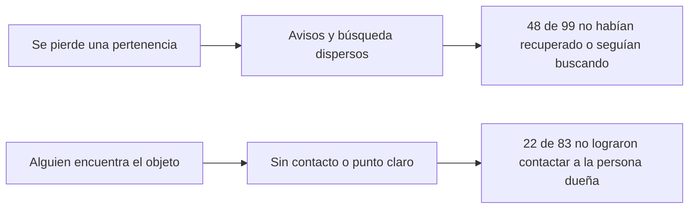
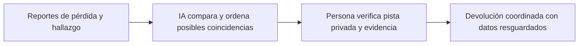

# LocalizaT  Análisis exploratorio y diagramas

## Fuente y criterio de lectura

Archivo: `LocalizaT _ Respuestas encuesta exploratoria.xlsx`, hoja `Form Responses 1`, 214 registros del 3 y 4 de octubre de 2026. El enlace se difundió entre contactos y estos lo compartieron con otras personas. Por tanto, el sondeo es de conveniencia y **no representa estadísticamente a toda la Sierra de Zongolica**. También hay participantes de Orizaba y otras zonas. Se clasificó cada registro según la experiencia elegida en la pregunta 3 y se usaron únicamente las preguntas de esa rama. Noventa registros clasificados como pérdida contenían además respuestas en la rama de hallazgo; esos campos cruzados no se contaron como personas adicionales.

| Experiencia elegida | Personas | Parte del total |
|---|---:|---:|
| Perdí una pertenencia | 99 | 46.3 % |
| Encontré una pertenencia ajena | 83 | 38.8 % |
| Respondo por un establecimiento o institución | 31 | 14.5 % |
| Ninguna experiencia reciente | 1 | 0.5 % |

## Hallazgos útiles para la propuesta

| Pregunta y grupo | Resultado | Lectura práctica |
|---|---:|---|
| Recuperación entre quienes respondieron sobre una pérdida | 22 de 99 no la recuperaron; 26 de 99 todavía la buscaban | 48 de 99 no habían resuelto la pérdida al responder. |
| Recuperación entre quienes respondieron sobre una pérdida | 39 de 99 sí la recuperaron; 12 prefirieron no responder | No todas las pérdidas terminan sin devolución. |
| Contacto entre quienes respondieron sobre un hallazgo | 22 de 83 no lograron contactar a la persona dueña; 18 no lo intentaron | Hay fricción de contacto; las motivaciones no se pueden inferir de estas categorías. |
| Mayor dificultad al devolver, grupo de hallazgo | 16 de 83 no tenían dónde dejarlo; 15 no querían contactar a una persona desconocida; 13 no sabían localizar a la persona dueña | La solución necesita un canal de contacto y custodia que preserve la privacidad. |
| Principal freno hipotético para usar el sitio, grupo de pérdida | 20 de 99 desconfiarían del manejo de datos; 16 no tendrían internet o datos en ese momento | La privacidad y el apoyo para registrar fuera de línea merecen prueba. |
| Posible participación de establecimientos | 4 de 31 sí; 8 tal vez si conocen condiciones; 9 no; 10 no podían decidir | La red de puntos de recepción aún no está comprometida. |

Las cifras son respuestas a preguntas distintas, con sus propias bases. No deben sumarse entre grupos ni describirse como prevalencia regional. El dato de «48 de 99» combina dos opciones de respuesta mutuamente excluyentes: «No» y «Todavía la busco». El grupo de hallazgos no permite concluir que la gente no quiera devolver: las respuestas muestran obstáculos diversos y también personas que sí contactaron a la dueña.

## Decisiones para el piloto

1. Iniciar en una zona de la Sierra de Zongolica, con posibilidad de ampliación a otras localidades; no presentar a la cabecera municipal como el mercado total.
2. Confirmar primero puntos voluntarios y un protocolo de resguardo. Las respuestas de establecimientos no justifican asumir una red disponible.
3. Probar registro asistido para quien no tenga datos móviles y separar los detalles públicos de las pistas privadas de propiedad.
4. Comparar la IA con búsqueda simple usando reportes reales consentidos; medir coincidencias útiles, falsas alarmas, tiempo de contacto y devoluciones verificadas.
5. No prometer devolución automática: la IA propone coincidencias y una persona verifica antes de coordinar la entrega.

## Figura 1  Problema y evidencia

## Figura 2  Recorrido de LocalizaT

**Fuente primaria:** formulario exploratorio LocalizaT, 214 registros, 3 y 4 de octubre de 2026. La información de alcance geográfico se usa como objetivo de diseño, no como extrapolación estadística del sondeo.
