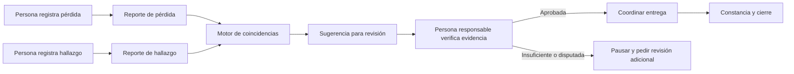
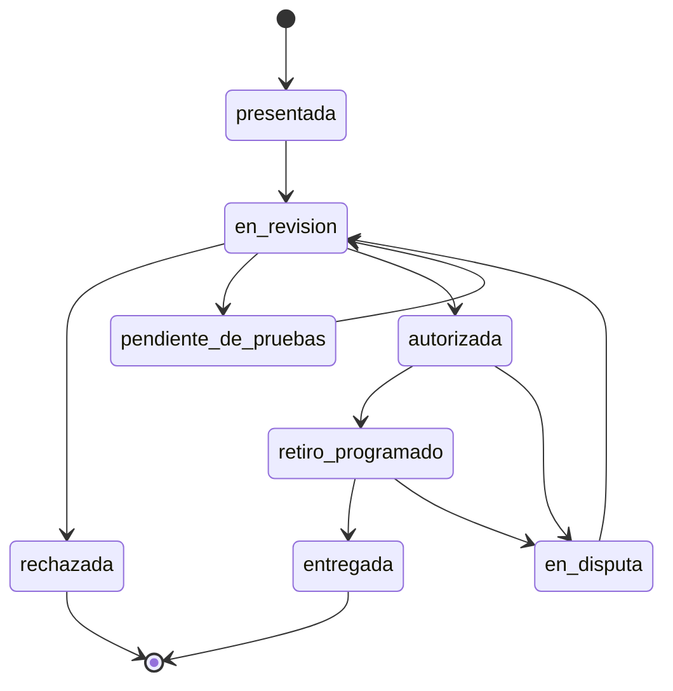
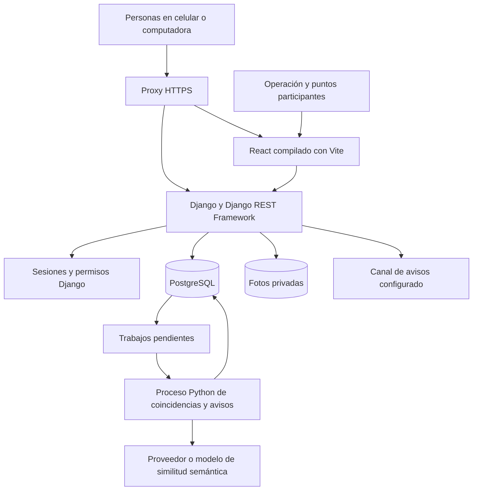
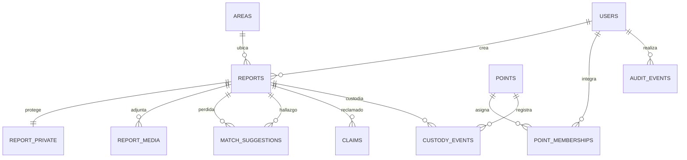
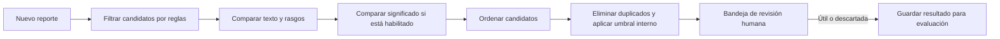

# Arquitectura del sistema LocalizaT

> **Documento de diseño (5 de octubre de 2026).** Explica las decisiones y el porqué de la arquitectura. Algunas partes cambiaron al construirse (por ejemplo, el alojamiento final es un servidor Contabo con Caddy y Neon). El estado actual del sistema está en [11 · Sistema completo](11_SISTEMA_COMPLETO_LocalizaT.md).

**Versión:** 0.3 — 5 de octubre de 2026  
**Estado:** arquitectura detallada que complementa la [especificación técnica general](06_ESPECIFICACION_TECNICA_GENERAL_LocalizaT.md). No describe software ya construido ni acuerdos de custodia cerrados.  
**Alcance:** servicio de objetos perdidos y encontrados para la **Sierra de Zongolica**, iniciado en una zona piloto y extensible a otras localidades.  
**Documentos relacionados:** [flujo operativo](../03_operacion/02_FLUJO_OPERATIVO_LocalizaT.md), [problema y alternativas](../01_proyecto/01_PROBLEMA_Y_ALTERNATIVAS_LocalizaT.md), [análisis de la encuesta](../02_investigacion/analisis_encuesta_214_y_diagramas.md) e [identidad v4](../06_diseno/GUIA_IDENTIDAD_LocalizaT_v4.md).

## 1. Decisión de producto

LocalizaT conecta un **reporte de pérdida** con un **reporte de hallazgo**, propone coincidencias y organiza una devolución verificada. Solo puede trabajar con objetos que alguien registre. La primera versión se concentra en objetos, casos, puntos participantes y entregas. Las pantallas de descubrimiento de lugares, eventos o red social de los primeros mockups no representan funciones comprometidas para este sistema.

El sondeo exploratorio reunió 214 respuestas compartidas entre contactos. Entre las 99 personas que respondieron sobre una pérdida, 48 no habían recuperado el objeto o seguían buscándolo. Entre las 83 que respondieron sobre un hallazgo, 22 no lograron contactar a la persona dueña. Entre 31 respuestas de establecimientos e instituciones, cuatro indicaron que sí considerarían participar en una prueba y ocho que tal vez lo harían si conocieran las condiciones. Son señales de diseño, **no una estimación estadística de toda la Sierra ni compromisos de los establecimientos**. Los denominadores y el método están en el análisis enlazado arriba.

### Objetivos medibles del piloto

1. Que una persona pueda registrar una pérdida o un hallazgo desde un celular y reciba un folio para seguimiento.
2. Que el sistema encuentre posibles pares incluso cuando las descripciones utilicen palabras diferentes.
3. Que un responsable pueda revisar reclamaciones sin revelar contactos, pistas de propiedad ni la ubicación exacta del objeto.
4. Que cada recepción, traslado y entrega en un punto participante deje constancia de quién tuvo el objeto y cuándo.
5. Que se pueda medir cuántos hallazgos registrados terminan en devolución correcta, cuánto tarda el proceso y cuánto trabajo exige.

**Límite de la promesa:** la IA no verifica propiedad, no autoriza entregas y no garantiza recuperar un objeto. La voluntad de reportar un hallazgo y la participación de puntos siguen siendo condiciones humanas y operativas.

## 2. Usuarios, funciones y permisos

| Actor | Necesita hacer | Acceso permitido |
|---|---|---|
| Persona que perdió algo | Registrar, corregir su reporte, consultar estado y presentar evidencia. | Sus reportes y reclamaciones; información pública mínima de hallazgos potenciales. |
| Persona que encontró algo | Registrar hallazgo, elegir si lo custodia temporalmente o lo entrega a un punto, recibir seguimiento. | Su reporte y el estado de entrega; nunca la pista privada de quien reclama. |
| Personal de un punto | Recibir, inventariar, custodiar y entregar objetos autorizados. | Casos asignados a su punto; ubicación interna e historial de custodia de esos casos. |
| Responsable de operación | Revisar coincidencias, reclamaciones, disputas y excepciones. | Expedientes necesarios para su trabajo; acciones auditadas. |
| Administrador | Incorporar puntos, asignar permisos, configurar zonas y categorías. | Administración y auditoría; acceso a datos sensibles solo si la tarea lo exige. |
| Visitante sin cuenta | Conocer el servicio y consultar avisos autorizados. | Categoría, zona amplia y fecha aproximada; ningún dato de contacto, pista secreta o dirección de resguardo. |

Una persona asistida por personal de un punto puede tener un caso con folio sin usar correo electrónico. El operador registra que actuó por encargo, el medio de contacto elegido y el consentimiento correspondiente. El folio por sí solo **no da acceso** a datos privados: el seguimiento requiere un segundo factor o verificación por el personal responsable.

## 3. Reglas de operación que guían el software

- Un reporte de pérdida y uno de hallazgo son expedientes distintos. Se pueden vincular varias sugerencias y descartar cada una con motivo.
- La descripción pública se redacta para orientar la búsqueda. La **pista de propiedad** se almacena separada y solo la ve el equipo autorizado que verifica la reclamación.
- Una persona puede reclamar un hallazgo, pero una sugerencia de IA no crea ni aprueba una reclamación por sí misma.
- Puede haber varios reclamantes. Mientras exista una disputa abierta, el objeto no se entrega.
- La entrega requiere una autorización humana registrada y una constancia de retiro. Una restricción en la base de datos debe impedir dos entregas finales para el mismo objeto.
- Si un punto recibe físicamente un objeto, cada cambio de responsable queda en una bitácora de custodia. Un reporte hecho por el hallador **no significa** que LocalizaT custodie el objeto.
- La dirección exacta del punto de resguardo se comparte solo después de verificar la reclamación y acordar el retiro, según el protocolo del punto.
- No se incluyen en el primer piloto efectivo, documentos oficiales, llaves, celulares u otras categorías sensibles hasta definir reglas específicas de verificación y custodia. La lista final se acuerda con los puntos participantes.

### Recorrido principal



### Estados del caso

Los estados se aplican a la **reclamación**; el reporte y la custodia conservan estados propios. Así se evita que una coincidencia de IA parezca una entrega aprobada.



La aprobación y entrega se realizan dentro de transacciones que vuelven a comprobar el estado actual. La interfaz puede estar desactualizada; la base de datos es la que impide una entrega incompatible.

## 4. Arquitectura elegida para el primer producto

Se propone una **aplicación web adaptable a celular** con **React en el navegador** y **Django en Python** como dueño de las reglas, la API y los permisos. PostgreSQL guarda los datos. Un proceso Python, construido dentro del mismo proyecto Django, atiende coincidencias y avisos en segundo plano. **Docker Compose** levanta estos componentes y el proxy web de manera reproducible. Un mismo repositorio reúne el producto; sus módulos tienen límites claros. El sitio público y el panel operativo usan la misma API.

La web se entrega por HTTPS. El navegador llama a rutas `/api/` de Django; Django valida entrada, sesión y permisos antes de consultar PostgreSQL. El proceso en segundo plano toma trabajos pendientes, compara reportes y deja sugerencias para revisión. Las fotos viven en almacenamiento privado controlado por la aplicación. Un proveedor de correo o mensajería se incorpora cuando esté decidido qué canal usarán las personas en el piloto. React no se conecta directamente a PostgreSQL.



**Despliegue inicial propuesto:** un entorno de pruebas separado del entorno productivo. En desarrollo, Docker Compose ejecuta Django, React/Vite, el proceso Python y PostgreSQL en la computadora del equipo. Para un piloto real, Compose puede ejecutar proxy, Django, proceso Python y PostgreSQL en un VPS, con volúmenes persistentes y copias de seguridad fuera de ese servidor. También puede ejecutar los mismos contenedores de aplicación y conectar Django a PostgreSQL alojado por separado. En ambos casos, LocalizaT conserva su código, modelos, permisos y API; ningún proveedor de base de datos sustituye el backend.

Docker organiza servicios y facilita repetir el entorno; **un volumen persistente no es una copia de seguridad**. La configuración de producción debe usar imágenes fijadas, secretos fuera del repositorio, comprobaciones de salud, reinicio controlado y solo el proxy expuesto a Internet. Las [recomendaciones de Docker para Compose en producción](https://docs.docker.com/compose/how-tos/production/) permiten una configuración adicional específica de ese entorno.

Para mantener sesiones sencillas, la versión publicada servirá la web y `/api/` bajo **el mismo dominio** mediante un proxy. En desarrollo, Vite puede redirigir `/api/` a Django. Así se usan cookies de sesión protegidas y la [protección CSRF de Django](https://docs.djangoproject.com/en/6.0/howto/csrf/) sin depender de guardar tokens de acceso en el navegador.

### Módulos internos

| Módulo | Responsabilidad | Datos principales |
|---|---|---|
| Identidad y permisos | Inicio de sesión, asignación de rol y vínculo con puntos. | Personas, roles y membresías. |
| Reportes | Crear, editar y cerrar pérdidas y hallazgos. | Reportes, zonas, categorías y fotos. |
| Coincidencias | Filtrar candidatos, puntuar y explicar sugerencias. | Sugerencias, versión del método y descartes. |
| Reclamaciones | Recibir evidencia, revisión humana y decisión. | Reclamaciones, pruebas privadas y motivos. |
| Puntos y custodia | Recepción, inventario, traslado y entrega. | Puntos, actas y movimientos. |
| Avisos | Comunicar cambios de estado según preferencias. | Plantillas, intentos y entregas de mensajes. |
| Auditoría y métricas | Registrar decisiones y calcular resultados agregados. | Eventos de auditoría y métricas del piloto. |

Los módulos se comunican mediante funciones de servicio de Django y trabajos registrados en la base. Una acción de negocio que cambie varias tablas —por ejemplo, autorizar una reclamación y reservar un objeto— se hace con `transaction.atomic()` y bloqueo del registro del hallazgo. Los trabajos de IA y avisos pueden reintentarse; usan identificadores únicos para no crear sugerencias o mensajes duplicados.

## 5. Tecnologías propuestas y motivo

| Capa | Elección inicial | Razón y condición |
|---|---|---|
| Backend | **Django en Python** | Modelos, migraciones, autenticación, permisos y reglas del negocio quedan en código propio. Su [guía de despliegue](https://docs.djangoproject.com/en/6.0/howto/deployment/checklist/) distingue la configuración de desarrollo de la de producción. |
| API | **Django REST Framework** | Expone los reportes, reclamaciones y custodia a la web con validación y permisos en Django; véase su [guía inicial](https://www.django-rest-framework.org/tutorial/quickstart/). |
| Frontend | **React con TypeScript y Vite** | La interfaz aprende React directamente y se publica como archivos estáticos; la [documentación de React](https://react.dev/learn/build-a-react-app-from-scratch) incluye Vite para este enfoque. |
| Interfaz | HTML accesible, CSS y componentes reutilizables | Formularios rápidos en celular, campos claros y colores de la identidad v4. La guía de marca define el uso del verde, ocre y logo. |
| Base de datos | **PostgreSQL** | Conserva relaciones, transacciones y restricciones de integridad. Su extensión [`pg_trgm`](https://www.postgresql.org/docs/current/pgtrgm.html) permite una búsqueda textual aproximada para la comparación base. |
| Contenedores | **Docker y Docker Compose** | Una imagen para Django/API y proceso Python; otra para el frontend compilado y proxy; PostgreSQL en su contenedor o alojamiento externo. Compose define servicios, red interna, volumen y comprobaciones de salud; véase la [guía oficial de Docker para Django](https://docs.docker.com/guides/django/). |
| Proxy | **Caddy** para el piloto en VPS | Sirve la web estática, envía `/api/` a Django y gestiona [HTTPS automático](https://caddyserver.com/docs/automatic-https) cuando el dominio apunta al servidor. |
| Administración interna | **Panel de Django** para tareas iniciales; pantallas React para el flujo operativo diario | El panel permite gestionar catálogos y usuarios; la recepción, verificación y entrega tendrán pantallas adaptadas al trabajo del punto. |
| Alojamiento de datos | **PostgreSQL propio o PostgreSQL contratado por separado** | En local se usa una instancia de desarrollo. En el piloto se elige entre administrarlo en un VPS o pagar solo por la base de datos, según costo y capacidad de operación. |
| Similitud semántica | Servicio o modelo intercambiable; [`pgvector`](https://github.com/pgvector/pgvector) si la prueba lo justifica | Ayuda a comparar descripciones distintas. El proveedor y modelo se elegirán con una prueba de calidad, privacidad y costo. |
| Trabajos en segundo plano | **Comando de gestión Django** y tabla de trabajos en PostgreSQL para el piloto | Usa Python y evita añadir Redis al inicio. Si el volumen crece, se evaluará una cola dedicada. |
| Pruebas | Pruebas de reglas, acceso y recorridos reales en navegador | Especial atención a doble entrega, fuga de pistas privadas y reclamaciones conflictivas. Una herramienta posible para recorridos web es [Playwright](https://playwright.dev/docs/test-assertions). |

**Por qué React y no Next.js en la primera versión:** Next.js es un [framework de React](https://nextjs.org/learn/react-foundations/what-is-react-and-nextjs), así que no son tecnologías rivales del mismo nivel. Django ya será el servidor y la API. React con Vite deja un frontend más directo para aprender y evita mantener dos servidores de aplicación en el piloto. Si más adelante las páginas públicas necesitan renderizado desde servidor o una estrategia de posicionamiento que lo justifique, se podrá valorar Next.js sin trasladar las reglas de negocio fuera de Django.

Esta selección es una **recomendación de arquitectura**, no una compra. Antes de crear cuentas o pagar, comparar disponibilidad local, costos vigentes, exportación de datos y capacidad de soporte del equipo. Mantener migraciones de Django, copias de PostgreSQL y archivos exportables para poder cambiar de alojamiento.

### Estructura inicial del repositorio

```text
localizat/
  backend/
    config/                 # configuración de Django y rutas
    accounts/               # usuarios, roles y sesiones
    areas/                  # localidades y zonas
    reports/                # pérdidas, hallazgos y fotos
    matching/               # candidatos y evaluación de IA
    claims/                 # reclamaciones y decisiones
    custody/                # puntos, inventario y entregas
    notifications/          # avisos y trabajos pendientes
    audit/                  # historial y métricas
    tests/                  # pruebas de permisos y recorridos
    manage.py
  frontend/
    src/pages/              # pantallas de React
    src/components/         # elementos de la identidad v4
    src/api/                # cliente de la API Django
    src/types/              # contratos compartidos en TypeScript
  docs/                     # decisiones técnicas y protocolos
  deploy/
    compose.yaml            # desarrollo con Docker Compose
    compose.production.yaml # ajustes del VPS
    Caddyfile               # web estática, API y HTTPS
    Dockerfile.backend      # imagen Django y proceso Python
    Dockerfile.frontend     # compilación de React
```

El servidor Django concentra la lógica importante en servicios de cada módulo. Las vistas de la API reciben datos y devuelven resultados; no contienen por sí solas las reglas de autorización de una entrega. Las migraciones de Django describen cambios de esquema. El frontend se compila a archivos estáticos y nunca contiene credenciales de la base de datos.

### Opciones de alojamiento y aprendizaje

| Uso | Configuración | Límite importante |
|---|---|---|
| Aprender y programar en tu equipo | Docker Compose con React/Vite, Django, proceso Python y PostgreSQL | Sin costo de hosting; requiere tu computadora para ejecutar el sistema. |
| Demo pública con datos ficticios | Frontend estático y Django en [Render Free](https://render.com/docs/free); PostgreSQL en el [plan gratuito de Neon](https://neon.com/blog/neon-free-plan-1-gb-per-project) como **alojamiento de base solamente** | Es una adaptación de la aplicación, no un despliegue completo de Compose. Render apaga el servidor web tras inactividad y su disco es temporal; no ofrece un proceso de fondo permanente en ese plan. La demo no debe depender de subir fotos persistentes ni de coincidencias inmediatas. Verificar límites actuales antes de usarlo. |
| Piloto con objetos y datos reales | Docker Compose en VPS con proxy, Django, proceso Python, PostgreSQL y archivos privados; o PostgreSQL alojado aparte | Presupuestar dominio, copias externas, monitoreo, actualizaciones y tiempo de operación. Si se administra PostgreSQL en el VPS, el equipo también se encarga de respaldos y restauración. |

El [PostgreSQL gratuito de Render](https://render.com/docs/free) caduca a los 30 días y no incluye respaldos, por lo que no es una base adecuada para el piloto real. Neon permite probar PostgreSQL sin adoptar sus otros productos; aun así, una base gratuita tampoco sustituye una política de respaldo para datos reales. Los niveles gratuitos cambian y se comprobarán justo antes de desplegar.

### Ruta de aprendizaje sugerida

1. **Python y Django:** modelos, migraciones, panel de administración, sesiones y permisos; construir primero un reporte de pérdida y uno de hallazgo.
2. **PostgreSQL:** relaciones, restricciones e índices; practicar cómo impedir una doble entrega incluso si dos peticiones llegan al mismo tiempo.
3. **API con Django REST Framework:** validar y exponer los reportes; probar qué puede consultar cada rol.
4. **React con TypeScript y Vite:** formularios, navegación y consumo de la API; aplicar la identidad v4.
5. **Docker Compose y operación:** imágenes, red interna, volúmenes, fotos privadas, proceso Python para coincidencias, copias de seguridad y despliegue.
6. **IA:** comenzar con búsqueda por reglas y texto; añadir similitud semántica solo cuando haya casos de evaluación y un beneficio medible.

Cada etapa deja una parte utilizable del sistema. Aprender Next.js después seguirá siendo posible porque el conocimiento de React se conserva.

## 6. Datos y relaciones

### Entidades mínimas

| Tabla | Campos esenciales | Regla importante |
|---|---|---|
| `users` | `id`, credenciales gestionadas por Django, nombre de contacto opcional, estado | Modelo de usuario propio de Django desde la primera migración; sin perfil público obligatorio. |
| `point_memberships` | usuario, punto, rol, vigencia | El personal solo actúa en puntos asignados. |
| `areas` | zona, localidad, región, alias | La Sierra se modela como localidades configurables; el sistema no queda limitado a la cabecera. |
| `reports` | id, tipo pérdida/hallazgo, categoría, descripción pública, fechas, área, creador, estado | Los dos tipos comparten campos públicos; los privados se separan. |
| `report_private` | reporte, contacto cifrado o protegido, pista de propiedad, notas de revisión | Sin acceso público ni uso en el primer filtrado de IA. |
| `report_media` | reporte, archivo privado, tipo, visibilidad autorizada | Quitar metadatos de fotos y controlar tamaño/formato. |
| `match_suggestions` | pérdida, hallazgo, puntuaciones internas, explicación, versión, estado | Par único por versión activa; sugerencia no equivale a aprobación. |
| `claims` | hallazgo, reclamante, pérdida relacionada, estado, verificador, decisión | Pueden existir varias reclamaciones, pero una sola entrega final válida. |
| `custody_events` | hallazgo, acción, origen, destino, responsable, fecha, constancia | Historial de recepción, traslado y entrega. |
| `points` | nombre, zona, categorías aceptadas, horarios, capacidad, estado | Solo activos si existe acuerdo operativo. |
| `outbox_jobs` | tipo, referencia, clave de idempotencia, estado, reintentos | Procesa coincidencias y avisos con control de duplicados. |
| `audit_events` | actor, acción, entidad, fecha, motivo | Registro de decisiones, cambios de acceso y entregas. |



En el diagrama, `REPORTS` participa dos veces en sugerencias porque cada par tiene un identificador de pérdida y otro de hallazgo. La implementación impondrá que esos identificadores correspondan a tipos distintos y que la fecha y zona sean coherentes. Las fotos de objetos encontrados con números de serie, nombres, pantallas o documentos se tratan como información privada.

### Índices y restricciones esenciales

- Índices sobre tipo, categoría, estado, fecha y área para generar candidatos sin recorrer todos los reportes.
- Claves foráneas y validación de estado; una reclamación de hallazgo solo puede apuntar a un reporte de tipo hallazgo.
- Restricción de unicidad para impedir dos entregas finales activas del mismo reporte de hallazgo.
- Transacción con bloqueo del caso al autorizar o entregar. Un segundo operador recibe un conflicto claro y debe actualizar la pantalla.
- Los eventos de custodia se añaden en orden; una corrección se registra como evento nuevo con motivo, sin borrar el anterior.
- Eliminación programada de archivos huérfanos y reportes vencidos conforme a la política de conservación definida para el piloto.

## 7. Diseño del motor de coincidencias

El motor trabaja en dos etapas. Primero filtra por reglas baratas: tipo opuesto, categoría compatible, intervalo de fechas plausible y localidades o trayectos cercanos. Después ordena los pares candidatos con señales textuales y, si aporta valor medido, similitud semántica. Usa únicamente la descripción permitida para comparación. La pista privada, teléfonos y nombres no llegan al modelo de IA.



La puntuación es **interna**. La interfaz dice «posible coincidencia» y presenta motivos verificables, por ejemplo categoría, intervalo y rasgos compartidos. No muestra «95 % de probabilidad de ser tuyo». Cuando no haya IA disponible, el sistema conserva filtros y búsqueda textual para que se puedan seguir registrando casos.

La prueba de valor usará pares ficticios o datos reales anonimizados y autorizados, con una respuesta de referencia revisada por personas. Comparará el mismo conjunto con búsqueda base y con similitud semántica. Medirá **precisión entre las sugerencias revisadas**, **recuperación de pares verdaderos**, falsos avisos por caso y minutos de revisión. Se separan datos de ajuste y de evaluación para no medir solo ejemplos ya vistos. Si la mejora no compensa errores, tiempo y costo, el piloto mantiene la búsqueda base.

## 8. Interfaz y API

### Pantallas del primer alcance

1. Inicio con dos acciones claras: **Perdí algo** y **Encontré algo**.
2. Formularios breves por pasos: categoría, fecha aproximada, zona, descripción, foto opcional, contacto privado y consentimiento.
3. Confirmación con folio y explicación del siguiente paso.
4. Consulta de estado con acceso protegido.
5. Vista de posibles coincidencias con información limitada y solicitud de revisión.
6. Bandeja de operación: sugerencias, reclamaciones, decisiones y excepciones.
7. Panel del punto: recepción, inventario, traslados, retiro autorizado y constancia.
8. Administración de puntos, zonas, categorías y permisos.

El diseño usa el [logo v4](../06_diseno/GUIA_IDENTIDAD_LocalizaT_v4.md) y lenguaje directo. Los formularios deben funcionar con conexiones inestables: guardar borradores **no sensibles** en el dispositivo y permitir reintentar envíos sin duplicarlos. El registro asistido cubre los casos en que la persona no dispone de datos móviles. Una verdadera operación sin conexión para personal de puntos queda para una etapa posterior y requiere resolver conflictos de inventario.

### Contratos de API propuestos

| Operación | Ruta orientativa | Regla central |
|---|---|---|
| Crear reporte | `POST /api/reports` | Validar campos y clave de idempotencia. |
| Consultar o editar reporte propio | `GET/PATCH /api/reports/{id}` | Propietario o personal autorizado; estados limitan edición. |
| Subir fotografía | `POST /api/reports/{id}/media` | Validar archivo; almacenar privado y sanear metadatos. |
| Consultar sugerencias propias | `GET /api/reports/{id}/suggestions` | Respuesta filtrada; nunca devuelve pistas privadas. |
| Presentar reclamación | `POST /api/claims` | Identidad o registro asistido; limita intentos. |
| Resolver reclamación | `POST /api/claims/{id}/decision` | Solo verificador asignado; motivo obligatorio y transacción. |
| Recibir o mover objeto | `POST /api/custody-events` | Solo punto asignado; constancia y bloqueo del caso. |
| Registrar entrega | `POST /api/handovers` | Autorización vigente, sin disputa, actor y constancia. |

Las rutas son **un contrato de diseño**, no endpoints existentes. Las mutaciones validan datos en servidor, comprueban permiso sobre el caso y escriben auditoría. Para usuarios sin cuenta se puede ofrecer un enlace de acceso de un solo uso más una verificación adicional; el detalle se definirá al diseñar el canal de contacto.

## 9. Privacidad, seguridad y abuso

El acceso se diseña por función y por expediente. **Solo Django accede a PostgreSQL**; React no recibe credenciales de la base. Los permisos se comprueban en cada ruta y consulta de Django, incluida la pertenencia del personal a un punto y la propiedad del reporte. Django usa sesiones con cookies protegidas y defensa CSRF para cambios de datos. La [lista oficial de despliegue de Django](https://docs.djangoproject.com/en/6.0/howto/deployment/checklist/) guía la configuración de HTTPS, secretos y respaldos.

- **Datos públicos mínimos:** categoría general, intervalo temporal y zona amplia. No publicar números de serie completos, contenido de dispositivos, dirección exacta ni detalles usados para verificar.
- **Fotos:** almacenamiento privado, formatos y tamaños limitados, eliminación de metadatos de ubicación, revisión antes de hacer visible cualquier recorte. Enlace temporal solo al actor autorizado.
- **Identidad y acceso:** sesión protegida, caducidad, revocación de cuentas del personal cuando sale del punto, defensa CSRF y revisión periódica de roles. Una cuenta de administración no se comparte entre operadores.
- **Abuso:** límites por dirección y cuenta, protección contra intentos masivos de adivinar pistas, detección de reportes repetidos y revisión de reclamaciones sospechosas. Un usuario no ve si acertó una pista hasta que termina la revisión.
- **Auditoría:** registrar quién consultó expedientes sensibles, cambió permisos, autorizó o ejecutó una entrega. Los registros técnicos no incluirán pistas, fotos ni contactos completos.
- **Conservación:** definir antes del piloto plazos de cierre, borrado o anonimización, recuperación de copias y atención de solicitudes de datos. Esos plazos no se inventan en esta versión: necesitan acuerdo operativo y revisión jurídica aplicable.
- **Respaldo:** copias cifradas, una restauración ensayada antes del piloto y procedimiento para suspender entregas si el sistema pierde integridad.

Se revisarán las obligaciones legales de protección de datos y las responsabilidades de custodia **antes de operar con objetos reales**. El documento técnico no sustituye ese análisis.

## 10. Casos difíciles y comportamiento esperado

| Situación | Comportamiento del sistema |
|---|---|
| No hay coincidencia | Mantener reporte activo por el plazo acordado; comparar de nuevo al entrar hallazgos compatibles. |
| Coincidencia falsa | Permitir descarte con motivo; no avisar reiteradamente por el mismo par. |
| Dos personas reclaman el mismo objeto | Congelar autorización, registrar disputa y escalar. |
| Objeto ya entregado | Rechazar nuevas autorizaciones mediante transacción y restricción de datos. |
| Punto sin capacidad | No asignar más custodias; ofrecer otro punto solo si aceptó la categoría y el traslado. |
| Hallador conserva el objeto | Dejar claro quién lo tiene y acordar el método de entrega; nunca marcarlo como resguardado por un punto. |
| Sin internet durante el registro | Ofrecer asistencia presencial o guardar borrador local sin información sensible; registrar cuando haya conexión. |
| IA o proveedor no disponible | Mantener registro, filtros y búsqueda textual; procesar sugerencias pendientes después. |
| Objeto sensible o posible delito | Suspender el flujo normal y aplicar protocolo específico; no mostrar ni entregar desde una sugerencia automática. |

## 11. Calidad y pruebas antes del piloto

Las pruebas se centran en resultados que podrían causar daños o invalidar el piloto:

1. **Permisos:** una persona no puede ver contactos, pistas ni fotos privadas de otra; el personal de un punto no puede abrir casos de otro punto.
2. **Entrega única:** dos operadores que actúan casi al mismo tiempo no pueden autorizar dos entregas del mismo hallazgo.
3. **Auditoría:** toda decisión de reclamación y movimiento de custodia deja actor, fecha y motivo.
4. **Reintentos:** una conexión interrumpida no duplica reportes, sugerencias, constancias ni avisos.
5. **Recorridos completos:** pérdida, hallazgo, sugerencia, verificación, recepción, entrega y cierre; además, disputa y falso positivo.
6. **Uso en campo:** probar con teléfonos y conexiones reales de la zona piloto; medir tiempo de registro y errores de comprensión.
7. **Restauración:** recuperar una copia en un entorno separado y verificar que los expedientes y constancias se leen correctamente.

El criterio de salida del desarrollo no será solo «la pantalla funciona»: el equipo debe poder ejecutar y explicar el proceso de custodia, resolver casos conflictivos y reconstruir una entrega desde el historial.

## 12. Medición del piloto

| Indicador | Cálculo | Para qué sirve |
|---|---|---|
| Devolución verificada | Hallazgos entregados correctamente ÷ hallazgos elegibles registrados en el periodo | Resultado principal; especificar categorías y plazo. |
| Tiempo hasta devolución | Tiempo entre registro de hallazgo y entrega confirmada | Experiencia y costo operativo. |
| Utilidad de sugerencias | Pares útiles tras revisión ÷ pares revisados | Calidad de la lista que produce el motor. |
| Falsos avisos | Avisos descartados ÷ avisos enviados | Carga y molestia para personas. |
| Minutos por caso | Tiempo de registro, verificación y entrega | Dimensionar operación y precio institucional. |
| Uso de puntos | Puntos con actividad y que siguen participando ÷ puntos incorporados | Viabilidad de la red física. |
| Accesibilidad | Reportes asistidos, abandonos de formulario y problemas de conexión | Saber si el canal digital deja personas fuera. |

Se documentará el denominador, fecha y método de cada indicador. La primera comparación de IA usa el mismo conjunto de casos y revisión humana para los dos métodos. El informe del piloto distinguirá devoluciones confirmadas de coincidencias simplemente sugeridas.

## 13. Costos y capacidad

No hay una cifra defendible en pesos sin elegir zona, número de puntos, volumen, horas de operación y proveedor. El presupuesto separará **inversión inicial** y **gasto mensual**.

| Componente | Cómo presupuestarlo |
|---|---|
| Desarrollo inicial | Horas de análisis, diseño, programación, pruebas y puesta en marcha. |
| Operación de puntos | Minutos por recepción, almacenamiento, traslado y entrega; señalización y capacitación. |
| Infraestructura | Alojamiento de Django, proceso Python, PostgreSQL, archivos privados, copias externas, dominio y monitoreo. |
| IA | Reportes comparados × costo por procesamiento y evaluación; contemplar el modo sin IA. |
| Comunicación | Mensajes enviados, soporte y atención de reclamaciones. |
| Seguridad y cumplimiento | Revisión de permisos, documentos operativos y atención de incidentes. |

La capacidad inicial se calculará con un escenario de baja actividad y otro de crecimiento, a partir de conteos observados en el piloto. **214 respuestas de encuesta no equivalen a 214 usuarios activos ni a una previsión de reportes mensuales.** Antes de pagar servicios se pedirán precios vigentes y límites de uso del proveedor elegido.

## 14. Plan de construcción con criterios de avance

| Etapa | Entregable técnico | Evidencia para avanzar |
|---|---|---|
| 0. Definir operación | Zona piloto, categorías aceptadas, responsables de custodia y reglas de verificación. | Al menos un punto con condiciones concretas y protocolo revisado. |
| 1. Especificar | Historias de usuario, pantallas, permisos, estados y modelo de datos. | Recorridos comprendidos por personas y personal de punto. |
| 2. Base funcional | Proyecto Django, migraciones PostgreSQL, API, interfaz React, identidad, reportes, fotos privadas, folios, administración de zonas y panel. | Registro completo y permisos probados. |
| 3. Custodia y reclamación | Inventario, constancias, verificación, disputas y entrega única. | Casos normales y conflictivos resueltos en pruebas. |
| 4. Coincidencias | Búsqueda base, bandeja de revisión y experimento de similitud semántica. | Comparación documentada entre base e IA. |
| 5. Piloto controlado | Monitoreo, respaldo, atención de incidentes y medición. | Devoluciones verificadas y carga operativa conocida. |
| 6. Expansión | Más puntos y localidades, mejora de accesibilidad y capacidad. | Protocolo reproducible y fuente sostenible de operación. |

Las etapas pueden solaparse en un equipo pequeño, pero el **piloto con objetos reales** depende de acuerdos de custodia y revisión de datos. La arquitectura evita comprar funciones o infraestructura antes de conocer el volumen real.

## 15. Decisiones que todavía requieren evidencia

1. **Zona y puntos del piloto:** la encuesta sugiere interés, pero no identifica aliados comprometidos ni capacidad real.
2. **Categorías admitidas:** elegir objetos cuya propiedad y resguardo puedan verificarse con reglas claras.
3. **Canal de contacto:** decidir si el piloto usará correo, SMS, llamada asistida u otro medio según conectividad y costo.
4. **Autoridad de verificación:** designar quién puede aprobar, escalar y resolver disputas; separar aprobación y entrega cuando sea posible.
5. **Plazos de conservación y resguardo:** acordarlos con los puntos y revisarlos jurídicamente.
6. **Proveedor de IA:** elegirlo solo después de medir beneficio, costo y tratamiento de datos sobre ejemplos autorizados.
7. **Modelo de sostenimiento:** la arquitectura admite servicio gratuito para ciudadanía y posible pago institucional, pero el comprador y el precio aún deben validarse.

## 16. Fuentes técnicas consultadas

- [Django: lista de comprobación para desplegar](https://docs.djangoproject.com/en/6.0/howto/deployment/checklist/).
- [Django: protección CSRF](https://docs.djangoproject.com/en/6.0/howto/csrf/).
- [Django REST Framework: guía inicial](https://www.django-rest-framework.org/tutorial/quickstart/).
- [React: crear una aplicación con Vite](https://react.dev/learn/build-a-react-app-from-scratch).
- [Next.js: relación entre React y Next.js](https://nextjs.org/learn/react-foundations/what-is-react-and-nextjs).
- [PostgreSQL: búsqueda aproximada con `pg_trgm`](https://www.postgresql.org/docs/current/pgtrgm.html).
- [pgvector: búsqueda vectorial en PostgreSQL](https://github.com/pgvector/pgvector).
- [Docker: contenedores para Django y PostgreSQL](https://docs.docker.com/guides/django/).
- [Docker: uso de Compose en producción](https://docs.docker.com/compose/how-tos/production/).
- [Caddy: HTTPS automático](https://caddyserver.com/docs/automatic-https).
- [Render: límites del alojamiento gratuito](https://render.com/docs/free).
- [Neon: anuncio de su plan gratuito de PostgreSQL, octubre de 2026](https://neon.com/blog/neon-free-plan-1-gb-per-project).
- [Playwright: pruebas y afirmaciones de interfaz](https://playwright.dev/docs/test-assertions).

Las decisiones de producto y las cifras de la encuesta provienen de los documentos locales enlazados al inicio. Las fuentes externas sustentan capacidades técnicas de las herramientas; no prueban por sí mismas que LocalizaT ya sea viable en campo.
