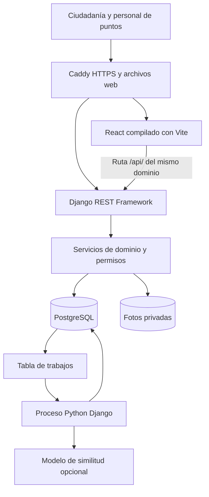
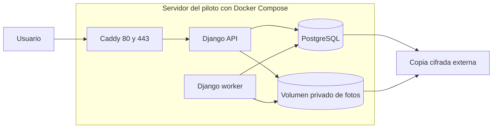
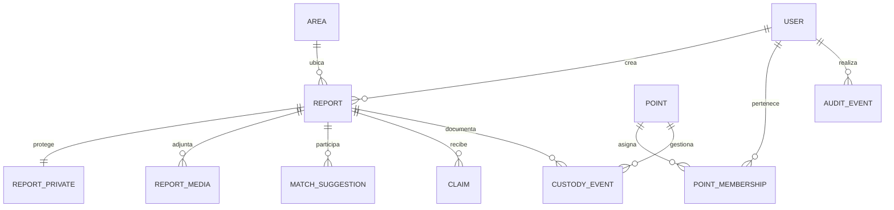
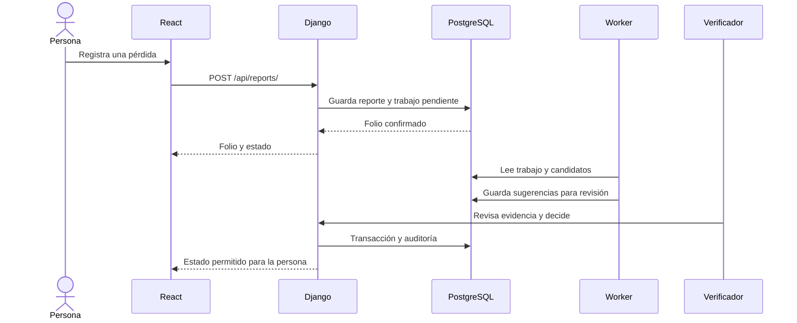
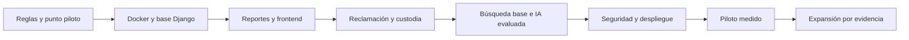

# Especificación técnica general de LocalizaT

> **Documento de diseño (5 de octubre de 2026).** Desde entonces se agregaron la IA semántica, el correo, las fotos privadas, las denuncias y la preparación de producción. El estado actual está en [11 · Sistema completo](11_SISTEMA_COMPLETO_LocalizaT.md).

**Versión:** 1.0 — 5 de octubre de 2026  
**Estado:** backend modular e interfaz React en desarrollo: cuentas, reportes, catálogo moderado, coincidencias por reglas, reclamaciones, custodia y entrega confirmada están implementados y conectados a pantallas. Faltan IA semántica, validación del piloto y preparación de producción. No hay puntos de custodia comprometidos. Véanse el [estado real del backend](07_BACKEND_IMPLEMENTADO_LocalizaT.md) y la [interfaz implementada](../06_diseno/INTERFAZ_IMPLEMENTADA_LocalizaT.md).  
**Alcance territorial:** Sierra de Zongolica. La primera operación se limitará a una zona y a puntos que acepten el protocolo.  
**Stack acordado:** Python, Django, Django REST Framework, PostgreSQL, React, TypeScript, Vite y Docker Compose.  
**Propósito:** servir como mapa único de lo que se construiría, cómo se desplegaría y qué debe comprobarse antes de usarlo con objetos reales.

La [arquitectura detallada](05_ARQUITECTURA_DEL_SISTEMA_LocalizaT.md) desarrolla módulos, datos y alternativas de alojamiento. El [flujo operativo](../03_operacion/02_FLUJO_OPERATIVO_LocalizaT.md) describe el trabajo humano. El [análisis de 214 respuestas](../02_investigacion/analisis_encuesta_214_y_diagramas.md) informa prioridades de diseño, sin representar estadísticamente a toda la Sierra.

## 1. Qué resuelve el sistema

LocalizaT relaciona reportes de objetos perdidos con reportes de objetos encontrados. Ayuda a quien quiere devolver algo a encontrar un camino claro y a quien lo perdió a seguir un caso sin publicar datos sensibles. La IA ordena **posibles coincidencias**; la propiedad se verifica por una persona y la entrega queda registrada. El sistema no localiza físicamente un objeto sin reporte, no obliga a devolverlo y no decide automáticamente quién es su dueño.

El MVP se concentra en objetos, reportes, reclamaciones, puntos participantes y devoluciones. Las pantallas de Stitch sobre lugares, eventos o comunidad general son referencias visuales, no funciones del MVP. La interfaz debe usar la [identidad v4](../06_diseno/GUIA_IDENTIDAD_LocalizaT_v4.md).

## 2. ¿Este stack cumple lo necesario?

**Sí, como base técnica.** Django puede ejecutar las reglas y exponer una API; PostgreSQL permite relaciones, restricciones y transacciones; React muestra formularios y paneles; Docker Compose organiza los servicios. Docker facilita repetir el entorno en otra computadora o servidor. Hace falta construir y probar las reglas de negocio, acordar la custodia física y respaldar los datos: esas obligaciones no aparecen resueltas por instalar el stack.

Para la convocatoria, el reglamento del Challenge NAUFest 2026 pide explicar el problema, la solución y el valor concreto de la IA. No prescribe Django, Docker ni una plataforma terminada. Esta especificación apoya la **viabilidad** de la propuesta, pero el entregable de la categoría Texto sigue sujeto a su formato y extensión propios.

## 3. Alcance funcional por versión

| Versión | Incluye | Condición de salida |
|---|---|---|
| **MVP técnico** | Crear pérdida y hallazgo; folio; zona y fecha aproximadas; contacto y pista privados; búsqueda base; lista de sugerencias; panel de revisión. | Una persona puede completar ambos recorridos y un operador puede revisar sin ver datos ajenos. |
| **Piloto operativo** | Puntos confirmados; inventario y constancias; reclamación, disputa, autorización y entrega; avisos; métricas y respaldos. | El protocolo humano y los casos de doble reclamación están probados con el punto participante. |
| **Mejora de IA** | Similitud semántica para descripciones diferentes, explicación de señales y medición contra búsqueda base. | Mejora comprobada en pares útiles sin exceso de falsos avisos ni costo injustificado. |
| **Expansión regional** | Más localidades y puntos, capacidad, asistencia de registro y soporte. | El proceso se repite sin depender del fundador en cada caso. |

### Requisitos funcionales del piloto

| ID | Comportamiento verificable | Prioridad |
|---|---|---|
| RF-01 | Crear reporte de pérdida con categoría, fecha o intervalo, zona amplia, descripción, contacto privado y pista privada. | Obligatorio |
| RF-02 | Crear reporte de hallazgo, distinguir entre objeto retenido por hallador y objeto recibido por un punto. | Obligatorio |
| RF-03 | Entregar folio y seguimiento protegido; el folio solo no abre el expediente privado. | Obligatorio |
| RF-04 | Sugerir pares por reglas de fecha, categoría y zona, más búsqueda textual. | Obligatorio |
| RF-05 | Permitir descartar o conservar cada sugerencia con motivo, sin aprobar automáticamente la reclamación. | Obligatorio |
| RF-06 | Registrar reclamación, evidencia y decisión de una persona autorizada. | Obligatorio |
| RF-07 | Impedir dos entregas finales del mismo hallazgo incluso ante peticiones simultáneas. | Obligatorio |
| RF-08 | Registrar recepción, traslado, responsable y entrega si hay punto físico. | Obligatorio |
| RF-09 | Permitir reporte asistido y dejar constancia de qué operador lo creó. | Obligatorio para el piloto con puntos |
| RF-10 | Medir devoluciones verificadas, tiempo, falsos avisos y minutos de trabajo. | Obligatorio para evaluar el piloto |
| RF-11 | Comparar semánticamente descripciones por IA con una evaluación reproducible. | Experimento, sujeto a resultado |

### Requisitos de calidad

- **Privacidad:** no mostrar contacto, pista de propiedad, dirección de resguardo ni foto privada a visitantes o usuarios ajenos al expediente.
- **Integridad:** cada entrega se relaciona con una autorización vigente y una constancia; el historial de custodia no se borra al corregir errores.
- **Disponibilidad:** si falla la IA, el registro y la búsqueda base siguen funcionando; si falla la red del usuario, puede reintentar sin duplicar el caso.
- **Accesibilidad:** formularios claros, navegación por teclado, etiquetas legibles y prueba en teléfonos y conexiones reales de la zona inicial.
- **Portabilidad:** código, migraciones, exportación de PostgreSQL y archivos permiten cambiar de proveedor. Las imágenes y la base se respaldan por separado.
- **Mantenibilidad:** módulos con límites, pruebas de permisos y estados, documentación de despliegue y cambios de esquema versionados.

## 4. Personas y permisos

| Rol | Puede | No puede |
|---|---|---|
| Visitante | Leer explicación y avisos públicos mínimos. | Ver contactos, pistas o ubicación exacta. |
| Reportante de pérdida | Crear, editar según estado, seguir y reclamar su caso. | Ver pistas de otros o liberar una entrega. |
| Reportante de hallazgo | Registrar y seguir su hallazgo, indicar quién lo conserva. | Decidir propiedad ajena. |
| Personal de punto | Recibir y mover objetos de su punto, ver solo casos asignados. | Abrir expedientes de otros puntos o aprobar reclamaciones fuera de su función. |
| Verificador | Revisar evidencia y aprobar, rechazar o escalar. | Entregar un caso disputado sin resolver. |
| Administrador | Configurar puntos, categorías, áreas y permisos. | Saltarse auditoría o alterar el historial de custodia. |

El control de acceso se implementa en Django por **rol y objeto**. No basta con ocultar un botón en React: cada endpoint vuelve a comprobar quién solicita la acción y sobre qué expediente. Django administra las sesiones; la web publicada y `/api/` comparten dominio, con cookie protegida y defensa CSRF.

## 5. Arquitectura de software

El backend es un monolito modular de Django. Esto significa un solo proyecto Python con aplicaciones internas para cuentas, reportes, coincidencias, reclamaciones, custodia, avisos y auditoría. Django REST Framework expone los datos permitidos. React con TypeScript y Vite construye la interfaz. PostgreSQL es la fuente de verdad. Un comando de gestión de Django procesa trabajos pendientes sin bloquear el formulario.



**Caddy** es el proxy propuesto para el VPS: entrega el frontend compilado, envía `/api/` y `/admin/` a Django y gestiona HTTPS cuando el dominio y DNS están configurados. El panel de administración de Django sirve para catálogos y cuentas al principio; los recorridos de recepción y verificación ya tienen pantallas React específicas.

### Módulos Python

| Aplicación Django | Trabajo principal |
|---|---|
| `accounts` | Usuario propio, roles, sesiones y asignación a puntos. |
| `areas` | Región, municipios y localidades configurables; sin fijar toda la Sierra a la cabecera de Zongolica. |
| `reports` | Pérdidas, hallazgos, datos privados, estados y fotos. |
| `matching` | Candidatos, sugerencias, motivos, versiones del método y evaluación. |
| `claims` | Reclamaciones, pruebas, decisión, disputa y autorización. |
| `custody` | Puntos, recepción, inventario, traslado y entrega. |
| `notifications` | Avisos, preferencias, reintentos y trabajos pendientes. |
| `audit` | Historial de acciones y métricas agregadas. |

Las vistas de la API son delgadas: validan entrada y llaman servicios de dominio. Las decisiones de entrega viven en servicios transaccionales, con pruebas propias. Los eventos relevantes se registran con actor, fecha, motivo y objeto afectado.

## 6. Diseño con Docker Compose

Se usará **Docker Compose** desde el desarrollo. Los Dockerfiles fijarán las versiones base y construirán imágenes reproducibles. El archivo de producción añadirá ajustes de seguridad y operación. La [guía oficial de Docker para Django](https://docs.docker.com/guides/django/) muestra el patrón Django + PostgreSQL; la [guía de Compose en producción](https://docs.docker.com/compose/how-tos/production/) recomienda separar los ajustes de ese entorno.

| Servicio Compose | Desarrollo | Piloto en VPS |
|---|---|---|
| `db` | PostgreSQL con volumen persistente y comprobación de salud. | PostgreSQL en red interna; volumen propio o servicio externo si se decide contratarlo. Sin puerto público. |
| `api` | Django con recarga para programar. | Imagen de Django con servidor WSGI/ASGI apto para producción; solo red interna. |
| `worker` | Misma imagen Python, ejecutando el comando que procesa la tabla de trabajos. | Proceso separado con reinicios y supervisión; no atiende HTTP público. |
| `frontend` | Servidor Vite para aprender y ver cambios en el navegador. | Compilación de React a archivos estáticos, servidos por Caddy; Vite no permanece ejecutándose. |
| `proxy` | Opcional en local para ensayar el mismo dominio. | Caddy expone 80 y 443, entrega la web y enruta `/api/` a Django. |



**Persistencia:** los datos de PostgreSQL y las fotos privadas viven en volúmenes separados. El volumen conserva archivos entre recreaciones normales del contenedor, pero no protege contra falla del servidor, borrado accidental o corrupción. Las copias deben salir del VPS y se comprobarán mediante una restauración de prueba. Los certificados de Caddy también requieren persistencia adecuada.

**Secretos:** contraseñas de PostgreSQL, clave de Django y credenciales externas nunca van en Git, imágenes ni frontend. En desarrollo se usan archivos locales excluidos del repositorio; para producción se usarán [secretos de Compose](https://docs.docker.com/reference/compose-file/secrets/) u otro mecanismo de secretos del host. Solo `api` y `worker` reciben lo que necesitan. Docker recomienda separar secretos de variables comunes.

**Red y publicación:** la base de datos y el worker no exponen puertos a Internet. Caddy es la única entrada pública. Para configurar producción se desactiva `DEBUG`, se fija `ALLOWED_HOSTS`, se fuerza HTTPS y se ejecuta `python manage.py check --deploy` conforme a la [lista oficial de Django](https://docs.djangoproject.com/en/6.0/howto/deployment/checklist/). Los contenedores tienen usuario sin privilegios cuando la imagen lo permita, límites razonables y comprobaciones de salud.

**Despliegue:** construir imágenes, hacer copia antes de una migración de riesgo, aplicar migraciones Django una sola vez, verificar la salud de API/worker/base y publicar. Hay que documentar cómo volver a la versión anterior; un cambio de esquema irreversible necesita un plan de migración propio. Docker Compose administra contenedores, mientras que el equipo administra el VPS, la base, los secretos y las copias.

### Estructura propuesta del futuro código

```text
localizat/
  backend/             # proyecto y aplicaciones Django
  frontend/            # React, TypeScript, Vite y estilos
  deploy/
    compose.yaml
    compose.production.yaml
    Dockerfile.backend
    Dockerfile.frontend
    Caddyfile
  docs/                # especificaciones, decisiones y manuales
  .env.example         # nombres de variables sin secretos reales
```

Estos archivos son una **estructura planificada**. Este documento no crea todavía contenedores ni código del sistema.

## 7. Base de datos y estados

Los modelos principales serán `User`, `Point`, `PointMembership`, `Area`, `Report`, `ReportPrivate`, `ReportMedia`, `MatchSuggestion`, `Claim`, `CustodyEvent`, `OutboxJob` y `AuditEvent`. Django administrará sus migraciones; las restricciones que protegen una entrega única se añadirán a PostgreSQL y se probarán con operaciones simultáneas.



Un `Report` tiene tipo `lost` o `found`; la pareja sugerida siempre une tipos opuestos. `ReportPrivate` guarda contacto y pista fuera de consultas públicas. `MatchSuggestion` tiene dos claves foráneas explícitas: `lost_report_id` y `found_report_id`, junto con versión del algoritmo, motivos y estado de revisión. `Claim` representa una reclamación humana. `CustodyEvent` registra recepción, cambio de responsable y entrega.

Estados orientativos: reporte `borrador → activo → cerrado`; sugerencia `pendiente → revisada/descartada`; reclamación `presentada → en_revision → autorizada/rechazada/en_disputa → entregada` cuando corresponda. Cada transición permitida se prueba y registra. Para autorizar se bloquea el hallazgo con `select_for_update()` dentro de `transaction.atomic()` y se verifica nuevamente que no esté entregado ni disputado; Django [documenta ese bloqueo](https://docs.djangoproject.com/en/6.0/ref/models/querysets/#select-for-update).

## 8. API y contratos entre frontend y backend

| Ruta de diseño | Actor | Resultado |
|---|---|---|
| `POST /api/reports/` | Ciudadanía o personal asistente | Crea pérdida o hallazgo y devuelve folio. |
| `GET /api/reports/{id}/` | Autor o personal autorizado | Devuelve solo los campos permitidos para ese rol. |
| `PATCH /api/reports/{id}/` | Autor según estado | Cambia campos editables; conserva auditoría. |
| `POST /api/reports/{id}/media/` | Autor o personal autorizado | Valida y guarda una foto privada. |
| `GET /api/reports/{id}/suggestions/` | Autor o verificador | Lista señales públicas de posibles coincidencias. |
| `POST /api/claims/` | Reclamante | Abre reclamación con evidencia privada. |
| `POST /api/claims/{id}/decision/` | Verificador | Aprueba, rechaza o escala con motivo. |
| `POST /api/custody-events/` | Personal del punto | Anota recepción, traslado o entrega. |
| `GET /api/me/` | Sesión iniciada | Devuelve identidad y permisos activos. |

Son contratos previstos, no endpoints ya disponibles. Las peticiones que crean o cambian datos llevan una clave de idempotencia cuando pueda haber reintentos de red. El backend valida tipo, longitud, fecha, tamaño de foto y permisos. Los errores deben explicar qué puede corregir la persona sin filtrar si acertó una pista secreta.



## 9. IA y su evaluación

El motor comienza por **filtros deterministas**: pérdida frente a hallazgo, categoría compatible, fechas plausibles y zona o trayecto. Luego usa búsqueda textual de PostgreSQL. La IA semántica se agrega si una prueba muestra que recupera pares que la búsqueda base pierde, por ejemplo «morral azul» frente a «mochila azul oscura». Las pistas secretas, números de contacto y nombres no entran en la comparación.

El worker deja una lista ordenada con razones observables, como categoría, intervalo y rasgos; la puntuación técnica no se anuncia como probabilidad de propiedad. Una persona revisa. Si el modelo o su proveedor falla, el registro y la búsqueda base continúan. El modelo y su proveedor se decidirán con datos ficticios o autorizados y una comparación de **pares útiles, falsos positivos, pares verdaderos recuperados, tiempo de revisión y costo**. `pgvector` es una extensión posible de PostgreSQL, sujeta a necesidad y compatibilidad del alojamiento.

## 10. Seguridad, custodia y datos personales

- La vista pública ofrece categoría, zona amplia y fecha aproximada. Contactos, fotos de evidencia, pistas y localización exacta del resguardo permanecen privados.
- Las fotos se validan, se limita tamaño y formato, se retiran metadatos de ubicación y se entregan solo mediante una ruta autorizada de Django. El servidor no ejecuta archivos subidos.
- Las contraseñas y sesiones usan el sistema de Django. El personal tiene cuentas individuales, roles que vencen al salir de un punto y acciones auditadas.
- Se limitan los intentos de crear reportes y adivinar pistas; un fallo de verificación no informa qué pista era correcta.
- Un punto recibe físicamente un objeto solo cuando aceptó esa categoría y tiene protocolo. Cada recepción y entrega guarda folio, fecha, responsable y constancia.
- Múltiples reclamantes suspenden la entrega. Una sospecha de robo u objeto sensible sale del flujo ordinario y requiere revisión humana y protocolo específico.
- Antes del piloto se fijarán plazos de conservación, proceso de eliminación y atención de solicitudes sobre datos, con revisión jurídica aplicable.

## 11. Pruebas y criterios de salida

| Prueba | Resultado exigido antes del piloto |
|---|---|
| Permisos de API | Una cuenta no obtiene expedientes, fotos, pistas ni acciones de otra; el punto no ve casos de otro punto. |
| Concurrencia | Dos verificadores no logran entregar el mismo hallazgo dos veces. |
| Reintentos | Dos envíos con la misma clave no crean dos reportes ni dos constancias. |
| Estados | Una sugerencia no autoriza entrega; una disputa bloquea el retiro. |
| Archivos | Foto inválida o demasiado grande se rechaza; una foto privada no tiene URL pública permanente. |
| Operación | Un objeto puede rastrearse desde recepción hasta constancia de retiro. |
| Respaldo | La base y las fotos se recuperan en un entorno aislado mediante un ensayo documentado. |
| Campo | Las personas completan los formularios y el personal entiende el flujo en teléfonos y conectividad reales de la zona piloto. |

Las pruebas de reglas pueden usar el sistema de pruebas de Django; las de recorridos en navegador pueden usar Playwright. El despliegue se bloquea si fallan migraciones, permisos o pruebas de entrega. El equipo medirá tiempos y errores reales antes de fijar objetivos numéricos de rendimiento.

## 12. Operación, alojamiento y dinero

Para aprender, todo el stack puede correr localmente con Docker Compose. Una demo gratuita puede adaptar el frontend estático y Django a servicios gratuitos, pero **no equivale** al entorno del piloto: algunos servicios se suspenden por inactividad y otros no dan almacenamiento permanente ni procesos de fondo. El análisis de [opciones gratuitas y sus límites](05_ARQUITECTURA_DEL_SISTEMA_LocalizaT.md#opciones-de-alojamiento-y-aprendizaje) está en la arquitectura detallada.

Para el piloto se presupuestará un VPS u otro alojamiento durable con dominio, copias externas, monitoreo, actualizaciones, tiempo de operación y el canal de avisos. El costo inicial incluye desarrollo, pruebas, acuerdos, capacitación y señalización; el gasto mensual incluye servidor, datos, mensajes, IA si aporta valor y horas del personal. La encuesta de 214 respuestas no permite predecir cuántos reportes mensuales tendrá el sistema.

La métrica principal será **hallazgos elegibles registrados que terminan en devolución verificada**, con periodo y denominador definidos. También se medirán tiempo hasta devolución, falsas sugerencias, trabajo por caso, reportes asistidos y permanencia de puntos participantes.

## 13. Orden de implementación

1. Acordar zona, categorías, punto inicial y responsable de verificar; escribir el protocolo de custodia.
2. Preparar repositorio, Docker Compose local, imágenes, Django, React y PostgreSQL; asegurar que todo inicia con una instrucción documentada.
3. Crear modelo de usuario, áreas, reportes y migraciones; probar permisos desde el principio.
4. Construir formularios y seguimiento, más búsqueda base por reglas y texto.
5. Construir reclamaciones, verificación, custodia, entrega única y auditoría.
6. Incorporar worker y medir IA semántica contra la búsqueda base; activar solo si el ensayo justifica su uso.
7. Preparar VPS, Caddy, HTTPS, secretos, volúmenes, respaldos y restauración de prueba; ejecutar revisión de despliegue de Django.
8. Probar con puntos y personas en campo, registrar incidentes y decidir si ampliar a otras localidades.



## 14. Decisiones abiertas

| Decisión | Quién y con qué evidencia se cierra |
|---|---|
| Zona y punto piloto | Equipo y establecimiento interesado; visita y acuerdo concreto. |
| Objetos admitidos y prueba de propiedad | Operación y punto; simulaciones de reclamos y asesoría aplicable. |
| Correo, SMS o apoyo presencial | Entrevistas y prueba de conectividad/costo con usuarios de la zona. |
| Alojamiento de PostgreSQL y fotos | Cotizaciones, capacidad de respaldo y operación del equipo. |
| Proveedor o modelo de IA | Evaluación comparativa y revisión de datos enviados. |
| Plazos de resguardo y conservación | Acuerdo operativo y revisión jurídica antes de objetos reales. |
| Precio institucional o financiamiento | Costo por caso y entrevistas con un posible comprador. |

## 15. Fuentes técnicas

- [Docker: guía para contenedores de Django y PostgreSQL](https://docs.docker.com/guides/django/); [Compose en producción](https://docs.docker.com/compose/how-tos/production/); [secretos](https://docs.docker.com/reference/compose-file/secrets/).
- [Django: lista de despliegue](https://docs.djangoproject.com/en/6.0/howto/deployment/checklist/); [bloqueo de filas](https://docs.djangoproject.com/en/6.0/ref/models/querysets/#select-for-update).
- [Django REST Framework: guía inicial](https://www.django-rest-framework.org/tutorial/quickstart/).
- [React: inicio con Vite](https://react.dev/learn/build-a-react-app-from-scratch).
- [Caddy: HTTPS automático](https://caddyserver.com/docs/automatic-https).
- [PostgreSQL: búsqueda aproximada](https://www.postgresql.org/docs/current/pgtrgm.html); [pgvector](https://github.com/pgvector/pgvector).

Las fuentes técnicas describen capacidades de las herramientas. Las decisiones de producto, costos y operación siguen siendo hipótesis hasta probarlas con personas y puntos participantes.
