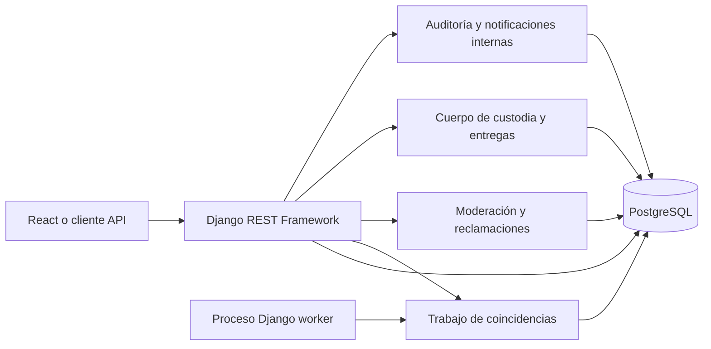
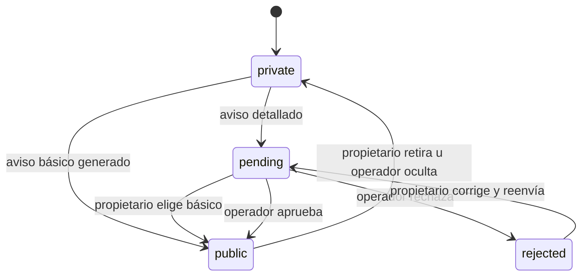
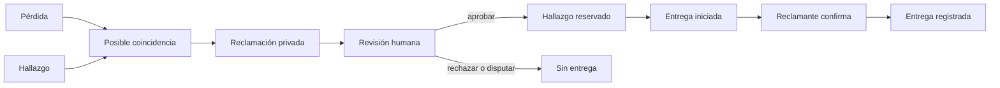

# Backend implementado de LocalizaT

> **Corte histórico (6 de octubre de 2026).** Varias limitaciones de abajo ya se resolvieron: motor semántico, correo, recuperación de contraseña, límites de intentos, denuncias, fotos y respaldos. El estado actual está en [11 · Sistema completo](11_SISTEMA_COMPLETO_LocalizaT.md).

**Corte:** 6 de octubre de 2026. Este documento describe el código que ya existe en `backend/`; la [especificación general](06_ESPECIFICACION_TECNICA_GENERAL_LocalizaT.md) conserva la visión del sistema completo.

## 1. Qué funciona

El backend es un monolito modular de Django y Django REST Framework sobre PostgreSQL. Docker Compose inicia `db`, `api`, `worker` y `frontend`. La interfaz React ya conecta el catálogo, los reportes, las publicaciones, las sugerencias, las reclamaciones, los avisos y la operación de custodia. El [documento de interfaz](../06_diseno/INTERFAZ_IMPLEMENTADA_LocalizaT.md) describe esas pantallas y las pruebas del recorrido. Su uso con personas reales aún requiere preparar y validar el piloto.



| Aplicación Django | Responsabilidad implementada |
|---|---|
| `accounts` | Usuario por correo, sesión y protección CSRF. |
| `reports` | Pérdidas y hallazgos privados; aviso básico inmediato o aviso detallado en revisión; cierre por propietario. |
| `matching` | Cola persistida y proceso de comparación por categoría, fecha, zona y palabras; sugerencias con motivos. |
| `claims` | Reclamación con evidencia privada, revisión humana, disputa, aprobación o rechazo. |
| `custody` | Puntos activos, miembros, recepción, traslado y entrega iniciada y confirmada por reclamante. |
| `notifications` | Bandeja interna por usuario y marcado de lectura. No envía todavía correos ni SMS. |
| `audit` | Registro de cambios y lectura de evidencia; métricas agregadas para el equipo. |

## 2. Cómo llega un aviso a otras personas

1. La persona registra una pérdida o hallazgo. El reporte completo queda visible solo para su cuenta y el personal autorizado.
2. Si elige `mode=instant`, Django genera el texto desde la categoría y usa «Sierra de Zongolica» como zona; ningún texto libre del reporte entra al aviso. El aviso queda visible al momento. El endpoint rechaza texto o zona enviados junto con este modo.
3. Si elige `mode=review`, envía un resumen y un área amplia. El backend bloquea patrones evidentes de correo, enlaces y números largos. Un usuario `is_staff` revisa en `/api/ops/publications/` y aprueba o rechaza con un motivo.
4. Los avisos básicos inmediatos y los detallados aprobados, si están activos, aparecen en `/api/public/reports/`. El catálogo devuelve siete campos: ID, tipo, categoría, resumen, área, fecha y fecha de publicación. Nunca entrega la pista de propiedad, el contacto ni la descripción privada.
5. La persona propietaria puede retirar la publicación o cerrar su reporte. Un reporte reservado o entregado desaparece del catálogo.



## 3. Coincidencias, reclamaciones y entrega

Cada nuevo reporte crea un `MatchingJob`. El proceso `worker` toma el trabajo, busca reportes del tipo opuesto y la misma categoría dentro de 14 días, y compara zona y palabras. Guarda el resultado en `MatchSuggestion`, con un puntaje **interno** y motivos legibles. Un par se guarda una sola vez; una sugerencia descartada no autoriza nada. Si el reporte opuesto aún no es público, la API de la persona oculta sus datos y deja el caso para revisión del equipo.

Una reclamación requiere cuenta, hallazgo público y activo, y una explicación privada. El hallador recibe un aviso interno, sin la evidencia. El personal `is_staff` revisa la evidencia y decide. Una restricción de base impide dos reclamaciones aprobadas para el mismo hallazgo. Al aprobar, el hallazgo pasa a `reserved` y sale del catálogo.

Un punto activo puede recibir un objeto; sus miembros registran la recepción. Los traslados requieren personal `is_staff`. Una entrega se inicia únicamente sobre una reclamación aprobada. La persona reclamante confirma desde su cuenta después de recibir el objeto. El hallazgo y, si se vinculó, la pérdida pasan a `returned`. `Handover.report` es único y el cierre usa transacciones y bloqueos de fila.



## 4. Rutas principales

| Método y ruta | Acceso | Uso |
|---|---|---|
| `GET /api/public/reports/` | Público | Catálogo paginado; filtros `kind`, `category`, `area`, `q`, `from`, `to`. |
| `GET /api/public/reports/{id}/` | Público | Datos mínimos de un aviso activo y visible. |
| `GET/POST /api/reports/` | Cuenta | Listar los propios y crear uno nuevo. Cada reporte trae `match_count`: coincidencias pendientes cuya contraparte ya es pública y activa. |
| `GET /api/reports/{id}/` | Propietario | Consultar su expediente sin la pista privada; también incluye `match_count`. |
| `POST/DELETE /api/reports/{id}/publication/` | Propietario | Publicar versión básica inmediata, solicitar revisión detallada o retirar. |
| `POST /api/reports/{id}/close/` | Propietario | Cerrar un caso activo. |
| `GET /api/reports/{id}/suggestions/` | Propietario | Ver posibles coincidencias con datos limitados. |
| `GET /api/ops/publications/` | Equipo | Cola de avisos pendientes. |
| `POST /api/ops/reports/{id}/publication/` | Equipo | Aprobar, rechazar u ocultar. |
| `GET /api/ops/suggestions/` | Equipo | Cola de coincidencias. |
| `GET/POST /api/claims/` | Cuenta | Listar reclamaciones propias o presentar una. |
| `GET /api/claims/{id}/` | Reclamante o equipo | Ver evidencia privada; el acceso del equipo queda auditado. Solo para el equipo añade `verification`: correo de quien reclama, descripción y correo de quien encontró el objeto, y la pista secreta del reporte de pérdida vinculado. |
| `POST /api/ops/claims/{id}/decision/` | Equipo | Aprobar, rechazar o disputar. |
| `GET /api/points/` | Público | Puntos activos y área amplia. |
| `GET /api/custody/inventory/` | Miembro de punto activo o equipo | Ver objetos retenidos en los puntos permitidos, sin pista de propiedad. |
| `POST /api/custody/intake/` | Miembro del punto o equipo | Registrar recepción por folio o ID. |
| `POST /api/custody/transfer/` | Equipo | Registrar traslado. |
| `GET /api/handovers/` | Reclamante, punto activo o equipo | Consultar entregas dentro del alcance de la cuenta. |
| `POST /api/handovers/` | Punto custodio o equipo | Iniciar entrega. |
| `POST /api/handovers/{id}/confirm/` | Reclamante | Confirmar recepción. |
| `GET /api/notifications/` | Cuenta | Consultar avisos internos. |
| `GET /api/ops/metrics/` | Equipo | Conteos operativos sin datos personales. |

En `POST /api/reports/{id}/publication/`, `{"mode":"instant"}` genera un aviso básico sin aceptar texto libre. `{"mode":"review","public_summary":"...","public_area":"..."}` va a revisión; omitir `mode` conserva el comportamiento anterior. En `POST /api/ops/reports/{id}/publication/`, el cuerpo es `{"decision":"approve","reason":"Resumen revisado"}`; también admite `reject` y `hide`. Para una reclamación: `{"found_report_id":"<uuid>","lost_report_id":"<uuid opcional>","evidence":"Detalle privado de al menos 15 caracteres"}`. La recepción admite `{"folio":"LT-...","point_id":1,"note":"Objeto recibido"}`. Los serializers de reclamaciones incluyen el resumen público del hallazgo y el estado de entrega; la lista no expone evidencia privada. La identidad de sesión incluye membresías en puntos activos para presentar las pantallas correspondientes; los permisos se vuelven a comprobar en Django.

## 5. Ejecución y comprobación

```powershell
docker compose up --build -d
docker compose ps
docker compose exec api python manage.py migrate --noinput
docker compose exec api python manage.py test accounts reports matching claims custody notifications audit
docker compose logs -f worker
```

Las pruebas incluyen publicación básica sin texto privado, conteo de coincidencias visibles y acceso reservado al contexto de verificación. Las migraciones viven dentro de cada aplicación. Para cargar un operador local: `docker compose exec api python manage.py createsuperuser`. Un punto se registra y activa desde `/admin/`, asignándole miembros. La app en `http://localhost:5173` permite recorrer las nuevas funciones. El equipo entra al panel de operación desde Mi espacio; los miembros de puntos ven el inventario y los controles de custodia autorizados. La configuración actual sigue siendo de desarrollo.

## 6. Límites antes de un piloto real

- La coincidencia actual usa reglas y palabras; **aún no usa IA semántica**. Su calidad debe medirse con casos revisados antes de añadir un modelo.
- La publicación inmediata solo muestra categoría, fecha y región. Texto libre y zona concreta requieren revisión. Todavía faltan controles de abuso y un mecanismo de denuncias para un piloto público.
- No hay verificación de correo, recuperación de contraseña, limitación distribuida de intentos de acceso ni envío de correo/SMS. Las notificaciones son internas.
- Los puntos existentes son datos de prueba o configuración: su activación en una operación real requiere acuerdo, capacitación y protocolo de custodia.
- El sistema no almacena todavía fotos privadas ni constancias firmadas. La confirmación de entrega registra la declaración de la cuenta reclamante, no prueba física independiente.
- Faltan política de retención, eliminación de datos, respaldos comprobados, HTTPS, observabilidad y pruebas con conectividad y dispositivos reales de la Sierra.
- El archivo `compose.yaml` y el servidor Django actual son para desarrollo local. Publicar el servicio requiere configuración y controles de producción separados.
