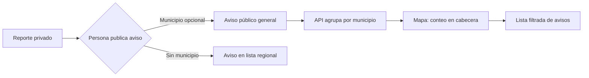
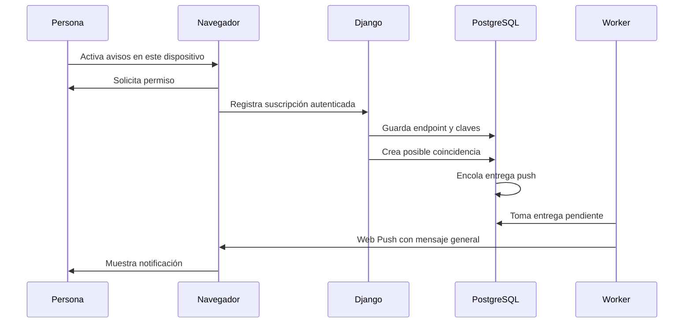

# Mapa regional y avisos push de LocalizaT

> **Corte histórico (6 de octubre de 2026).** El recorrido de avisos push sigue vigente. El mapa se rediseñó el 12 de octubre (relieve 3D y cabeceras de contexto) y las coincidencias ya usan el motor semántico. Ver [11 · Sistema completo](11_SISTEMA_COMPLETO_LocalizaT.md#12-mapa-de-la-sierra).

**Implementado el 6 de octubre de 2026.** Esta iteración añade un mapa público agregado y avisos push voluntarios para posibles coincidencias. El reconocimiento de coincidencias sigue usando el motor actual de reglas; esta iteración no convierte ese motor en IA semántica.

## Recorrido del mapa

1. Quien publica un aviso básico puede indicar uno de los 11 municipios iniciales o dejar la región general. Nunca se pide una coordenada exacta para publicar.
2. `GET /api/public/report-map/` aplica los filtros públicos del catálogo y cuenta únicamente reportes activos y publicados. Responde con totales por municipio y con el total sin municipio.
3. El mapa muestra los conteos sobre las **cabeceras municipales como referencias visuales**. Al elegir una zona se abre la lista filtrada. La lista de zonas funciona aunque WebGL falle.
4. Las coordenadas de las cabeceras proceden del [cuadro 1.2 de INEGI para Veracruz](https://www.inegi.org.mx/app/cuadroentidad/Ver/2018/01/1_2). Los 11 municipios son un primer conjunto regional; el alcance operativo del piloto debe validarse localmente.

El mapa usa MapLibre GL JS. En desarrollo emplea mosaicos de OpenStreetMap con atribución visible. Para tráfico de producción se debe configurar `VITE_MAP_TILE_URL` con un proveedor o infraestructura de mapas que acepte el volumen previsto y respetar la [política de mosaicos de OpenStreetMap](https://operations.osmfoundation.org/policies/tiles/). El cliente no descarga zonas para uso sin conexión.

## Recorrido de avisos push

1. En **Mi espacio → Novedades**, la persona activa voluntariamente los avisos en ese dispositivo. El navegador solicita permiso y crea una suscripción Web Push mediante el service worker.
2. Django guarda el endpoint y las claves de esa suscripción para la cuenta autenticada. El endpoint no aparece en el catálogo ni en la respuesta de otras cuentas.
3. Solo la creación de una `Notification` de tipo `match` encola una `PushDelivery`. Las solicitudes, publicaciones y entregas permanecen en la bandeja interna sin push.
4. El worker procesa la cola después de las tareas de coincidencias. El mensaje push es deliberadamente genérico; no revela categoría, ubicación, indicios de propiedad ni datos de contacto. Abre la bandeja de novedades.
5. El usuario puede desactivar la suscripción en ese dispositivo. Al cerrar sesión, el frontend también intenta desuscribirlo. Las entregas pendientes se eliminan al borrar la suscripción.

Las claves VAPID se configuran por entorno. La copia local tiene un par propio en `.env`, excluido de Git. En una instalación nueva, el servicio deja push desactivado hasta configurar `VAPID_PRIVATE_KEY`, `VAPID_PUBLIC_KEY` y `VAPID_SUBJECT`. La clave privada no debe ponerse en el frontend ni en documentos públicos. Web Push requiere un contexto seguro; `localhost` sirve para desarrollar, mientras que el despliegue necesita HTTPS. En iOS/iPadOS, Web Push funciona para aplicaciones añadidas a la pantalla de inicio en versiones compatibles, según [WebKit](https://webkit.org/blog/13878/web-push-for-web-apps-on-ios-and-ipados/).

## Límites y siguiente validación

- El mapa agrupa en Python los avisos públicos. Si el catálogo crece, conviene agregar en SQL y medir el tiempo de respuesta.
- La cola ofrece reintentos limitados y puede repetir un envío tras una caída del worker; el `tag` del service worker reduce duplicados visibles. No garantiza entrega cuando el navegador o el servicio push la rechaza.
- El permiso real y la recepción push deben probarse en Chrome/Firefox de escritorio y en un iPhone compatible añadido a inicio. Las pruebas automatizadas verifican la cola y el filtrado, no la red externa de push.
- El proveedor de mosaicos para producción, el alcance municipal exacto y la validación con personas de la Sierra siguen pendientes.
