# LocalizaT · Cómo funciona el sistema completo

**Versión:** 12 de octubre de 2026 · rama `produccion-completa`
**Para quién:** quien necesite entender LocalizaT de punta a punta (equipo, jurado de NAUFest, quien lo mantenga después). Cada sección empieza con la idea en palabras sencillas y luego entra al detalle técnico.

> **En una frase:** LocalizaT conecta a quien perdió algo con quien lo encontró en la Sierra de Zongolica. La IA sugiere posibles coincidencias entre descripciones, pero **siempre decide una persona**: el equipo comprueba un detalle secreto antes de cualquier entrega.

---

## Índice
1. [Panorama general](#1-panorama-general)
2. [Quién usa LocalizaT (actores y casos de uso)](#2-quién-usa-localizat-actores-y-casos-de-uso)
3. [El viaje de un objeto, de la pérdida a la devolución](#3-el-viaje-de-un-objeto-de-la-pérdida-a-la-devolución)
4. [Crear un reporte (con o sin señal)](#4-crear-un-reporte-con-o-sin-señal)
5. [El motor de coincidencias (la IA)](#5-el-motor-de-coincidencias-la-ia)
6. [Avisos públicos, moderación y denuncias](#6-avisos-públicos-moderación-y-denuncias)
7. [Reclamar, verificar y entregar](#7-reclamar-verificar-y-entregar)
8. [Avisos a las personas: bandeja, push y correo](#8-avisos-a-las-personas-bandeja-push-y-correo)
9. [Cuentas: registro, Google, verificación y recuperación](#9-cuentas-registro-google-verificación-y-recuperación)
10. [Estados de cada pieza](#10-estados-de-cada-pieza)
11. [Modelo de datos](#11-modelo-de-datos)
12. [Mapa de la Sierra](#12-mapa-de-la-sierra)
13. [Panel del equipo y métricas](#13-panel-del-equipo-y-métricas)
14. [Seguridad y privacidad](#14-seguridad-y-privacidad)
15. [Arquitectura técnica y despliegue](#15-arquitectura-técnica-y-despliegue)
16. [Operación diaria](#16-operación-diaria)
17. [Rutas de la API](#17-rutas-de-la-api)
18. [Límites conocidos y siguientes pasos](#18-límites-conocidos-y-siguientes-pasos)

---

## 1. Panorama general

**La idea:** la persona usa LocalizaT desde el navegador de su celular o computadora, y también puede instalarla como app. Todo pasa por un solo servidor con HTTPS. Una parte responde al momento (la API) y otra trabaja en segundo plano (el *worker*): compara reportes, manda avisos y envía correos.

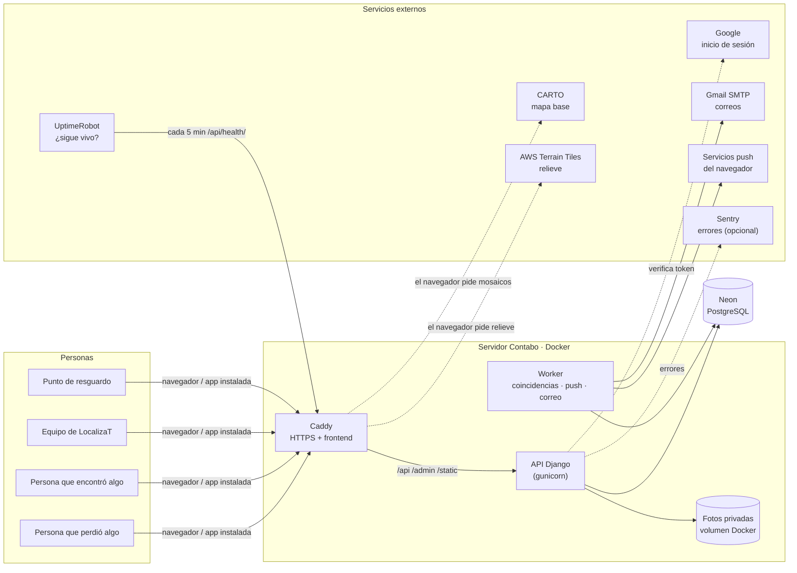

| Pieza | Qué hace | Tecnología |
|---|---|---|
| **Frontend** | Las pantallas: inicio, explorar, reportar, Mi espacio, panel del equipo. Funciona como app instalable (PWA). | React 19 + TypeScript + Vite |
| **Caddy** | Sirve el frontend, saca el certificado HTTPS solo y reenvía `/api`, `/admin` y `/static` a Django. | Caddy 2 |
| **API** | Reglas del negocio: cuentas, reportes, avisos, reclamaciones, custodia, permisos. | Django 5.2 + Django REST Framework |
| **Worker** | Trabajo en segundo plano: compara reportes, envía push y correos, y deja un «latido» cada 30 s. | Comando de Django `run_matching_worker` |
| **Base de datos** | La única fuente de verdad. | PostgreSQL en Neon |
| **IA de coincidencias** | Modelo de lenguaje que corre en el propio servidor (no se manda texto a terceros). | fastembed · `paraphrase-multilingual-MiniLM-L12-v2` |

---

## 2. Quién usa LocalizaT (actores y casos de uso)

**La idea:** hay cuatro tipos de personas y un actor automático (el worker). Cada una puede hacer cosas distintas; el sistema revisa los permisos en el servidor, no solo en la pantalla.

| Actor | Quién es | Qué puede hacer |
|---|---|---|
| **Visitante** | Cualquiera, sin cuenta. | Ver avisos públicos y el mapa, denunciar un aviso, dejar un comentario. |
| **Persona con cuenta** | Quien perdió o encontró algo. | Todo lo anterior, más reportar, subir fotos, publicar avisos, ver coincidencias, reclamar y confirmar una entrega. |
| **Equipo** (`is_staff`) | Personas de LocalizaT. | Moderar avisos y denuncias, decidir reclamaciones, ver métricas y comentarios. |
| **Punto de resguardo** | Una tienda, escuela o institución participante. | Recibir objetos en custodia e iniciar entregas de lo que tiene. |
| **Worker** | Proceso automático. | Comparar reportes y enviar avisos push y correos. |

### Casos de uso de la comunidad

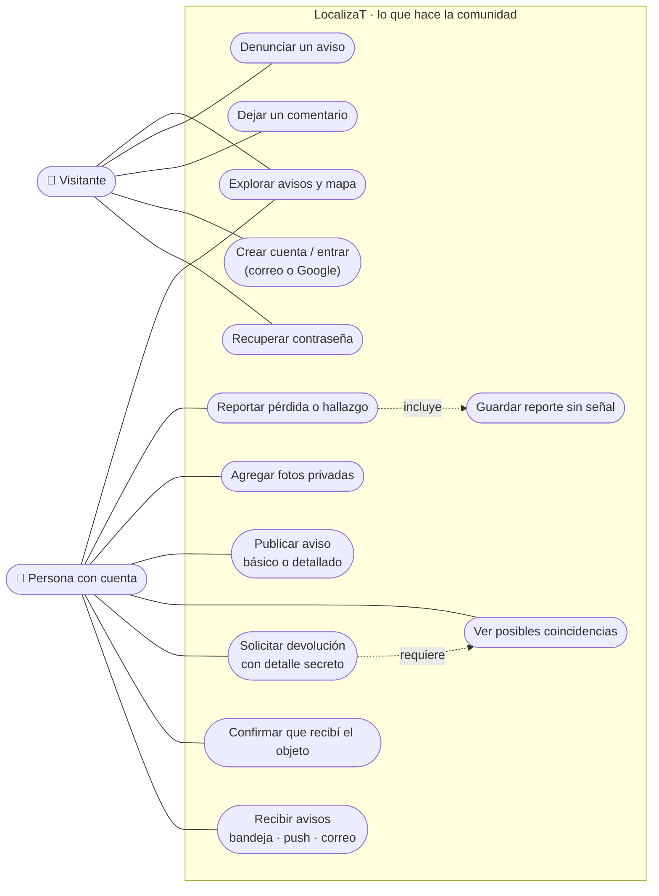

### Casos de uso del equipo y de los puntos

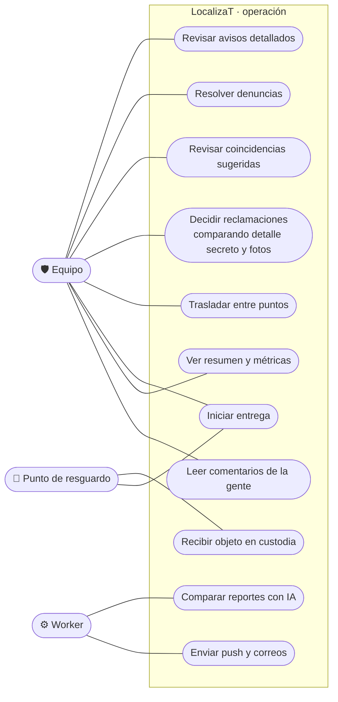

---

## 3. El viaje de un objeto, de la pérdida a la devolución

**La idea:** el sistema tiene dos mitades (como el logo, dos aros enlazados). Una persona reporta lo que perdió y otra lo que encontró. La IA las acerca, pero la devolución solo ocurre cuando el equipo comprobó que el objeto es de quien lo reclama.

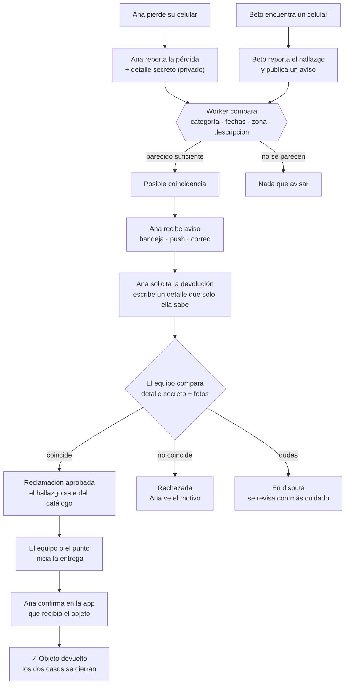

**Puntos clave**
- La coincidencia **nunca** confirma quién es el dueño: solo sugiere revisar.
- El **detalle secreto** de la pérdida nunca se publica. Solo lo ve el equipo al decidir una reclamación.
- Un objeto puede quedarse con quien lo encontró o pasar a un **punto de resguardo** (con folio e historial de custodia).

---

## 4. Crear un reporte (con o sin señal)

**La idea:** son tres pasos.
1. **Qué pasó:** perdí o encontré, y el tipo de objeto.
2. **Cómo es:** descripción, lugar, fecha, detalle secreto y fotos opcionales.
3. **Qué verá la comunidad:** aviso básico, aviso con mis palabras o nada.

Mientras se escribe, se guarda un borrador en el celular, **sin el detalle secreto**. Si no hay señal al final, la persona puede dejarlo listo para que se envíe solo después.

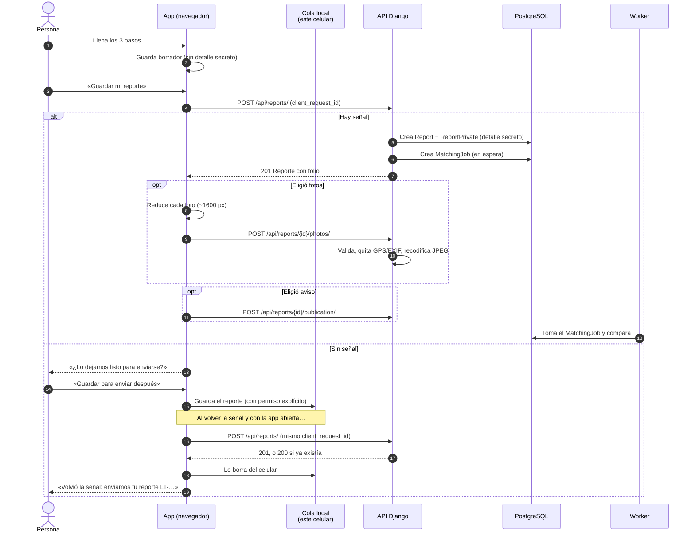

**Detalles técnicos**
- **Idempotencia:** cada reporte lleva un `client_request_id` (UUID) único por persona. Si se reenvía, el servidor devuelve el mismo reporte en lugar de duplicarlo.
- **Validaciones:** descripción de al menos 12 letras, fecha no futura, y detalle secreto obligatorio solo en pérdidas.
- **Fotos:** hasta 3 por reporte y 8 MB cada una. Se aceptan JPG, PNG, WEBP y GIF, y se rechazan las imágenes «bomba» de más de 40 megapíxeles. Se guardan **fuera** de cualquier carpeta pública.
- **Límite:** 20 reportes por hora por cuenta.

---

## 5. El motor de coincidencias (la IA)

**La idea:** cada vez que llega un reporte, el worker busca reportes «del otro lado» (si es pérdida, busca hallazgos) que sean del mismo tipo y de fechas cercanas. Luego mide qué tanto se parecen las descripciones, **aunque estén escritas con otras palabras** («chamarra de mezclilla» y «chaqueta de jean»). Solo si se parecen lo suficiente se crea una sugerencia.

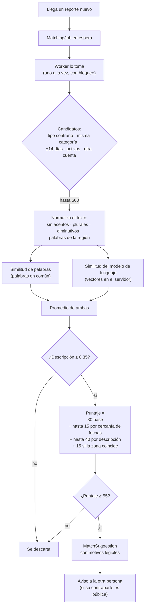

| Concepto | Valor | Por qué |
|---|---|---|
| Ventana de fechas | ±14 días | Un objeto encontrado meses después rara vez es el mismo. |
| Puerta de descripción | 0.35 | Así la fecha y la zona **solas** no bastan para sugerir. |
| Umbral para sugerir | 55 de 100 | Medido con casos de prueba: bajó las falsas alarmas de 54 a 3. |
| Palabras de la región | `REGIONAL_WORDS` en `matching/scoring.py` | «morral» = «bolsa», «cachucha» = «gorra», «mercado» = «plaza»… Se puede ampliar con lo que diga la comunidad. |
| Respaldo | Motor de reglas | Si el modelo no está disponible, compara solo con palabras y el servicio no se detiene. |

**Qué ve cada quien.** La persona solo ve la sugerencia si la contraparte es un **aviso público y activo**, con los datos públicos y nada privado. El equipo ve todas en el panel y puede descartarlas.

**Medir con casos reales:** `export_matching_cases` arma un archivo con las devoluciones aprobadas y `evaluate_matching` mide aciertos, primer lugar y falsas alarmas. Ver la [sección 16](#16-operación-diaria).

---

## 6. Avisos públicos, moderación y denuncias

**La idea:** un reporte es **privado** hasta que su dueño decida mostrarlo. Hay dos tipos de aviso:
- **Básico (al momento):** el sistema escribe el texto («Se busca: celular · Zongolica»), sin datos personales.
- **Con mis palabras:** lo escribe la persona y **el equipo lo revisa** antes de mostrarlo.

Si la comunidad denuncia un aviso varias veces, sale solo del catálogo hasta que el equipo decida.

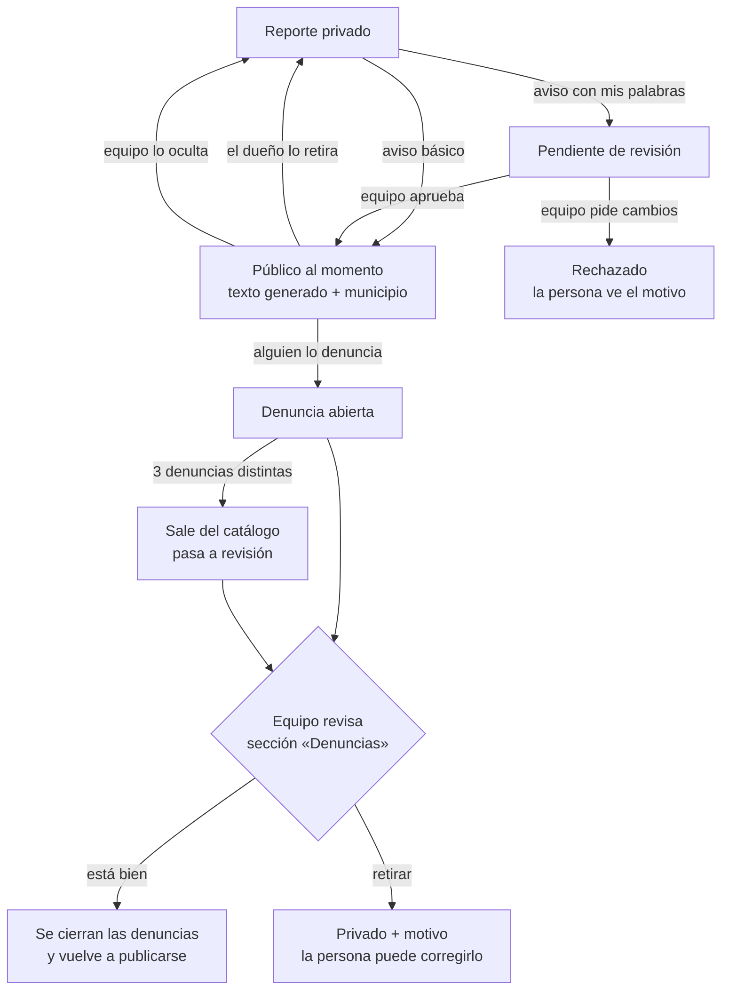

**Reglas que protegen a la gente**
- Un aviso con texto libre no puede llevar correos, enlaces, teléfonos ni números largos: se valida en el servidor.
- Se permiten como máximo 5 avisos básicos al día por cuenta.
- **Denuncias:** se puede denunciar con o sin cuenta. Cada persona cuenta **una sola vez** por aviso: se guarda una huella cifrada de su conexión, nunca la IP. Hay un límite de 10 denuncias por hora.
- **Motivos de denuncia:** datos personales, falso o engañoso, ofensivo, publicidad u otro.

---

## 7. Reclamar, verificar y entregar

**La idea:** quien reconoce su objeto en un aviso pide la devolución escribiendo un detalle que no aparece en el aviso. El equipo lo compara con el **detalle secreto** que esa persona escribió al reportar la pérdida y con las **fotos privadas**. Si coincide, se coordina la entrega. La devolución solo cuenta como hecha cuando **quien recibe confirma** en la app.

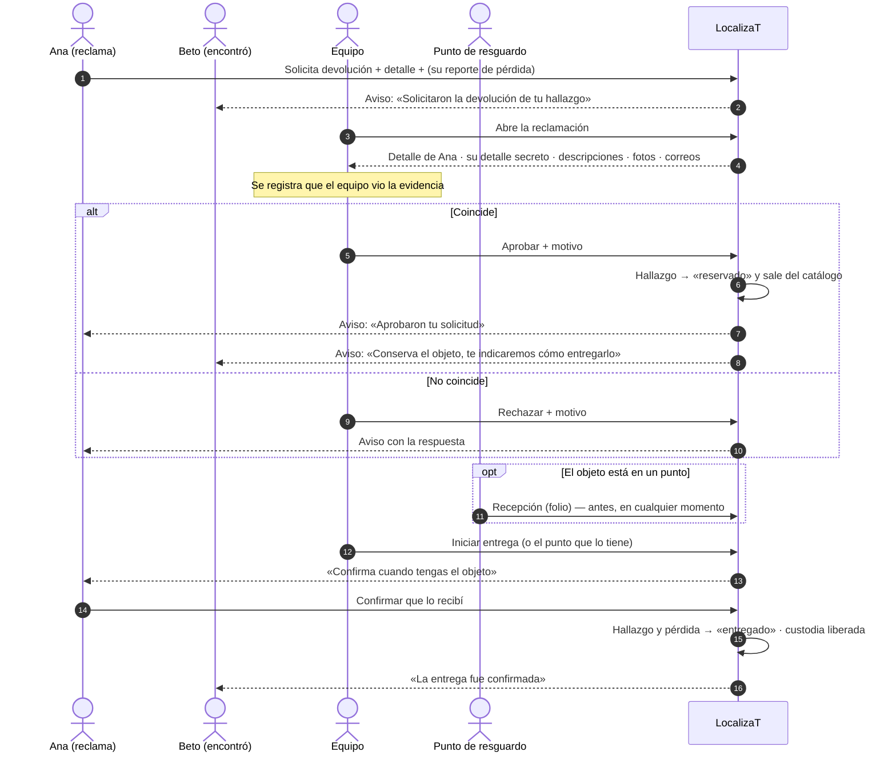

**Protecciones**
- No puedes reclamar tu propio hallazgo y solo hay una reclamación por persona y objeto, con un máximo de 5 al día.
- Solo puede haber **una** reclamación aprobada por hallazgo. Lo garantiza la base de datos, con bloqueo de fila al decidir.
- Cada decisión, cada consulta de evidencia y cada movimiento de custodia queda en la **bitácora** (`AuditEvent`).

---

## 8. Avisos a las personas: bandeja, push y correo

**La idea:** cuando pasa algo importante (una coincidencia, una respuesta del equipo, una entrega), se crea una **novedad** en la bandeja de la persona, la campana. A partir de ahí salen copias automáticas:
- **Push** al celular, si lo activó.
- **Correo**, si su correo está confirmado y no apagó los avisos.

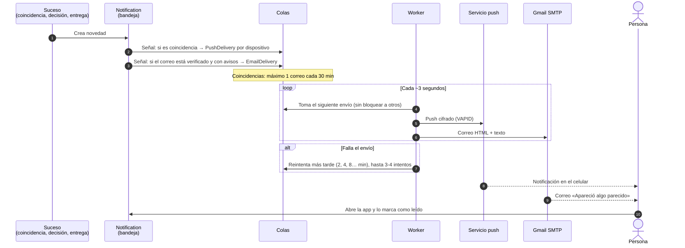

- Los correos de **un solo uso** (verificar y recuperar contraseña) se **borran de la base** en cuanto se envían.
- Sin servidor de correo configurado, el sistema funciona igual: los correos se escriben en el registro del worker.
- Remitente actual: `localizat.zongolica@gmail.com`, con contraseña de aplicación de Google. Límite: 500 correos al día.

---

## 9. Cuentas: registro, Google, verificación y recuperación

**La idea:** se puede entrar con **correo y contraseña** o con **Google**. Para mandar avisos por correo, el correo tiene que estar **confirmado**; así nadie llena de correos a otra persona escribiendo su dirección. Si alguien olvida su contraseña, recibe un enlace que sirve 2 horas y una sola vez.

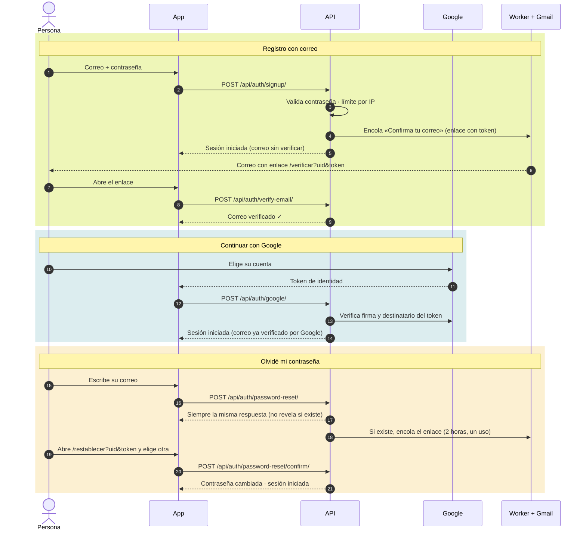

**Límites de intentos.** Se cuentan en una caché compartida por todos los procesos.

| Acción | Límite |
|---|---|
| Entrar (por IP) | 20 intentos fallidos cada 15 min |
| Entrar (por correo) | 6 fallos cada 15 min: frena a quien intenta adivinar contraseñas |
| Crear cuenta (por IP) | 8 por hora |
| Recuperar contraseña | 6 por IP y 3 por correo, por hora |
| Reenviar verificación | 3 por hora |
| API en general | 120/min sin cuenta · 240/min con cuenta |

---

## 10. Estados de cada pieza

**La idea:** cada cosa del sistema (un reporte, una reclamación, un envío) pasa por estados claros. Solo se permiten ciertos cambios, y cada uno queda registrado.

### Reporte (`Report.status`)
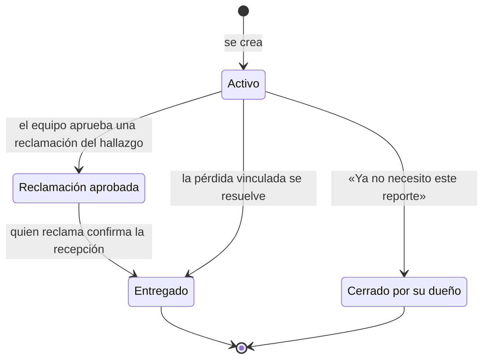

### Aviso público (`Report.publication_status`)
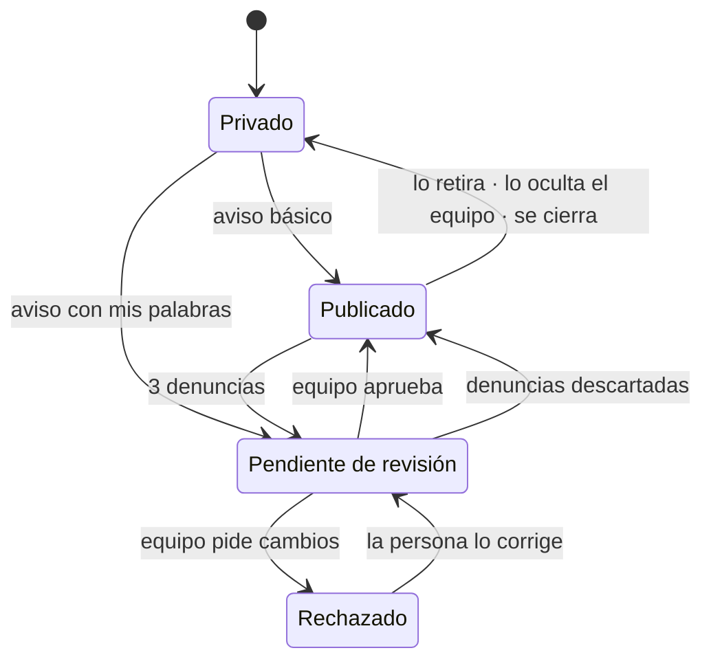

### Reclamación (`Claim.status`) y entrega (`Handover.status`)
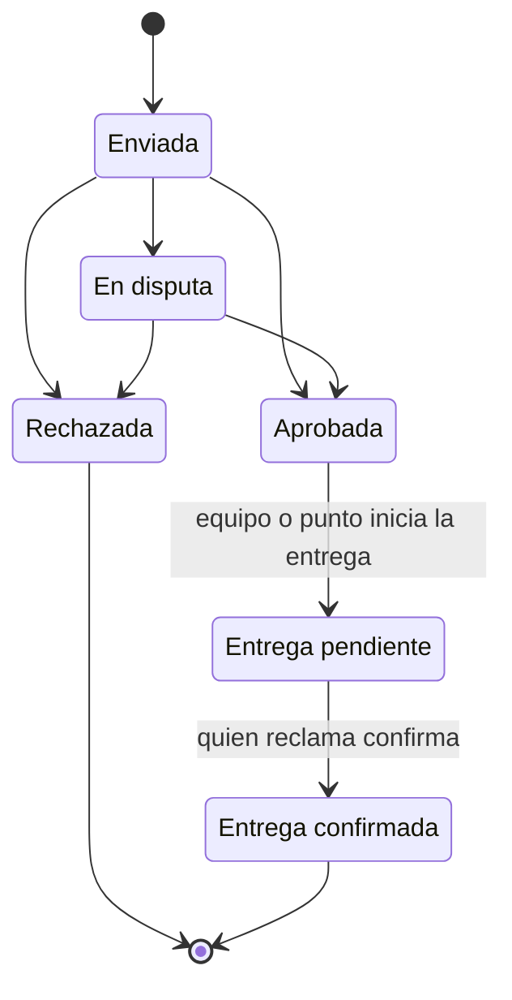

### Envíos (`EmailDelivery`, `PushDelivery`) y trabajos de comparación (`MatchingJob`)
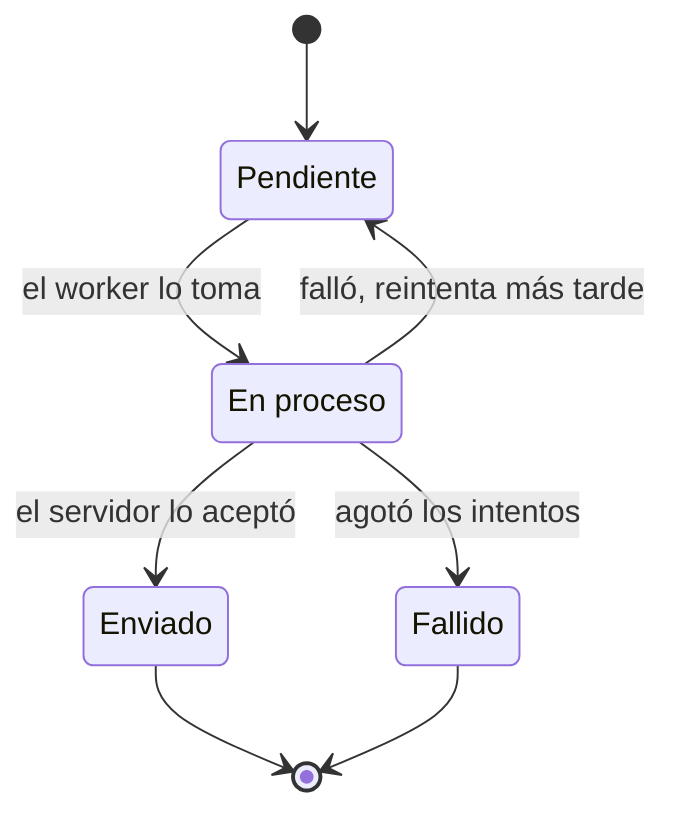

---

## 11. Modelo de datos

**La idea:** el centro es el **Reporte**. Sus datos privados (detalle secreto, fotos) viven en tablas aparte, para que nunca se cuelen en una respuesta pública.

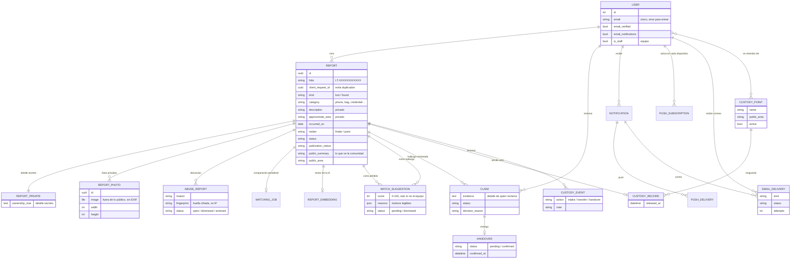

Además hay tablas de apoyo: `AuditEvent` (la bitácora de cada acción importante), `Feedback` (los comentarios de «¿Algo no se entendió?») y `localizat_cache` (los contadores de intentos y el latido del worker).

---

## 12. Mapa de la Sierra

**La idea:** el mapa muestra **cuántos avisos hay por municipio**, nunca dónde está un objeto ni una persona. Cada círculo se dibuja sobre la **cabecera municipal**, con coordenadas del INEGI.

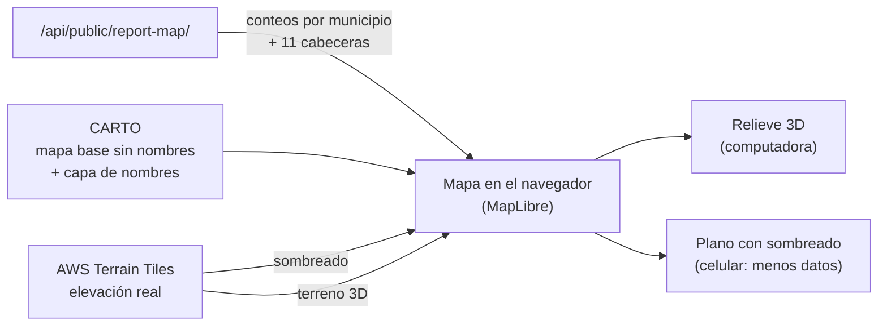

- **El anillo de cada círculo:** lima = encontrados, turquesa = se buscan. El tamaño crece con el número de avisos.
- **Contexto:** las 11 cabeceras aparecen siempre (las que no tienen avisos, como puntos pequeños con su nombre).
- **En el celular:** se mueve con dos dedos, para no atrapar el desplazamiento de la página. Respeta «reducir movimiento».
- La clave de CARTO viaja en cada mosaico; conviene limitarla al dominio en el panel de CARTO.

---

## 13. Panel del equipo y métricas

**La idea:** el equipo tiene una sola pantalla con todo lo que espera una decisión. Al entrar, se abre la sección que tiene trabajo pendiente.

| Sección | Para qué |
|---|---|
| **Avisos por revisar** | Aprobar o pedir cambios a los avisos con texto libre; ocultar avisos visibles. |
| **Reclamaciones** | Comparar el detalle de quien reclama con su detalle secreto, las descripciones y las fotos, y decidir. |
| **Coincidencias** | Ver los pares que sugirió la IA y descartar los que no tienen sentido. |
| **Denuncias** | Avisos que la gente reportó, con sus motivos. Dejarlos o retirarlos. |
| **Custodia** | Inventario de los puntos: recibir, trasladar e iniciar entregas. |
| **Comentarios** | Lo que la gente escribe en «¿Algo no se entendió?», con página, tipo de red y celular. |
| **Resumen** | Cifras del servicio y botón «Descargar cifras» (JSON). |

**Qué mide el Resumen** (solo conteos, nunca datos de una persona):
- reportes totales, pérdidas, hallazgos, de la semana y del mes;
- **objetos devueltos** y cuántos días tarda la mitad en volver;
- porcentaje de pérdidas que recibieron al menos una coincidencia;
- cuentas y cuántas tienen el correo verificado;
- reportes por semana, por categoría y por municipio;
- fallos por revisar (correos, comparaciones).

---

## 14. Seguridad y privacidad

**La idea:** se muestra lo mínimo y se protege lo demás. La regla de oro es que **nada privado puede llegar a una respuesta pública**, y eso se comprueba con pruebas automáticas.

| Dato | ¿Público? | ¿Quién lo ve? |
|---|---|---|
| Tipo de objeto, municipio, fecha y texto del aviso | Sí, si la persona publica | Todos |
| Descripción completa y zona exacta | No | La persona dueña y el equipo |
| **Detalle secreto** | **Nunca** | Solo el equipo, al decidir una reclamación (queda registrado) |
| **Fotos** | **Nunca** | La persona dueña y el equipo (cada vista del equipo queda registrada) |
| Correo | Nunca | El equipo, solo para coordinar una entrega aprobada |
| Denuncias | No | El equipo; de quien denuncia solo se guarda una huella cifrada |

**Medidas técnicas**
- **Conexión:** HTTPS siempre, con HSTS y cookies de sesión `Secure`, `HttpOnly` y `SameSite=Lax`. Protección CSRF en toda escritura.
- **Encabezados de seguridad:** `X-Content-Type-Options`, `Referrer-Policy`, `Permissions-Policy` y protección contra *clickjacking*.
- **Fotos:** se recodifican y pierden el EXIF, que incluye la ubicación GPS. Se entregan solo a través de Django, con `Cache-Control: private`.
- **Límites de intentos:** en cuentas, reportes, fotos, denuncias y comentarios ([sección 9](#9-cuentas-registro-google-verificación-y-recuperación)). Detrás de Caddy se lee la IP real (`NUM_PROXIES=1`).
- **Privacidad de la IA:** la descripción se compara **en el propio servidor**; no se envía a servicios externos.
- **Errores:** los del navegador llegan al equipo sin correo ni reportes. Sentry está configurado con `send_default_pii=False`.
- **Bitácora:** `AuditEvent` registra quién decidió qué y cuándo: publicaciones, reclamaciones, evidencia vista, custodia y denuncias.
- **Sin señal:** el borrador nunca guarda el detalle secreto. La cola de envío lo guarda **solo** si la persona lo acepta y lo borra al enviarse.

---

## 15. Arquitectura técnica y despliegue

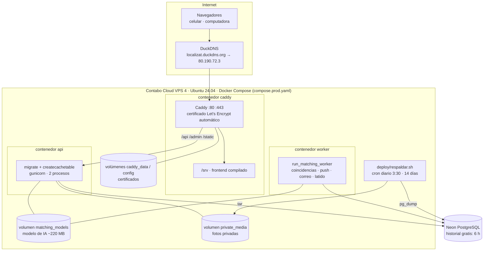

| Entorno | Cómo se levanta | Diferencias |
|---|---|---|
| **Desarrollo** | `docker compose up -d --build` (archivo `compose.yaml`) | PostgreSQL local en contenedor, Vite con recarga en vivo en `localhost:5173` y Django `runserver`. Los secretos están en `.env`. |
| **Producción** | `docker compose -f compose.prod.yaml up -d --build` | Neon, gunicorn, Caddy con HTTPS y volumen de fotos. Los secretos están en `.env.prod` (nunca en Git). |

**Variables importantes de `.env.prod`:** `DATABASE_URL`, `DJANGO_SECRET_KEY`, `DOMAIN`, `DJANGO_ALLOWED_HOSTS`, `DJANGO_CSRF_TRUSTED_ORIGINS`, `EMAIL_HOST` / `EMAIL_HOST_USER` / `EMAIL_HOST_PASSWORD` / `DEFAULT_FROM_EMAIL`, `VAPID_*` (push), `SENTRY_DSN` (opcional).

**Salud del sistema:** `GET /api/health/` responde `{"status": "ok", "worker": "ok"}`. Si la base no responde, da 503. Si el worker lleva más de 2 minutos sin latido, dice `"worker": "sin_latido"`. UptimeRobot vigila esa palabra.

---

## 16. Operación diaria

| Tarea | Comando o lugar |
|---|---|
| Publicar una versión nueva | `cd ~/LocalizaT && git pull && docker compose -f compose.prod.yaml up -d --build` |
| Ver si todo está vivo | `https://localizat.duckdns.org/api/health/` · `docker compose -f compose.prod.yaml ps` |
| Ver errores del worker o de correo | `docker compose -f compose.prod.yaml logs worker --tail 100` |
| Crear una cuenta del equipo | `docker compose -f compose.prod.yaml exec api python manage.py createsuperuser` |
| Registrar puntos de resguardo | `https://localizat.duckdns.org/admin` › Puntos de custodia |
| Respaldo manual | `sh deploy/respaldar.sh` |
| Restaurar | `sh deploy/restaurar.sh deploy/respaldos/base_FECHA.dump [fotos_FECHA.tar.gz]` |
| Volver a comparar todo tras cambiar la IA | `docker compose -f compose.prod.yaml exec worker python manage.py rematch_reports` |
| Medir la IA con casos reales | `exec worker python manage.py export_matching_cases --salida /tmp/casos_reales.json` y luego `evaluate_matching --cases /tmp/casos_reales.json --details` |
| Pruebas automáticas (desarrollo) | Backend: `TEST_DB_ENGINE=sqlite python manage.py test` (56 pruebas). Frontend: `npm test` y `npm run build`. |

---

## 17. Rutas de la API

Ver todas las rutas

| Método | Ruta | Acceso | Para qué |
|---|---|---|---|
| GET | `/api/health/` | Público | Salud de la base y del worker |
| GET | `/api/auth/csrf/` | Público | Token CSRF |
| POST | `/api/auth/signup/` · `/login/` · `/logout/` | Público / sesión | Cuenta con correo |
| POST | `/api/auth/google/` | Público | Entrar con Google |
| GET | `/api/auth/me/` · `/config/` | Público | Sesión actual · ID de cliente de Google |
| POST | `/api/auth/password-reset/` · `/password-reset/confirm/` | Público | Recuperar contraseña |
| POST | `/api/auth/verify-email/` · `/verify-email/resend/` | Público / sesión | Confirmar correo |
| POST | `/api/auth/preferences/` · `/api/auth/password/` | Sesión | Avisos por correo · cambiar contraseña |
| GET, POST | `/api/reports/` | Sesión | Mis reportes · crear reporte |
| GET | `/api/reports/{id}/` | Dueño | Detalle de mi reporte |
| POST | `/api/reports/{id}/close/` | Dueño | Cerrar mi reporte |
| POST, DELETE | `/api/reports/{id}/publication/` | Dueño | Publicar o retirar aviso |
| GET | `/api/reports/{id}/suggestions/` | Dueño | Posibles coincidencias |
| GET, POST | `/api/reports/{id}/photos/` | Dueño (ver: + equipo) | Fotos privadas |
| GET, DELETE | `/api/photos/{id}/` | Dueño / equipo | Ver o borrar una foto |
| GET | `/api/public/reports/` · `/{id}/` | Público | Catálogo de avisos |
| GET | `/api/public/report-map/` | Público | Conteos por municipio y cabeceras |
| POST | `/api/public/reports/{id}/abuse/` | Público | Denunciar un aviso |
| GET, POST | `/api/claims/` · `/api/claims/{id}/` | Sesión | Mis reclamaciones |
| POST | `/api/handovers/{id}/confirm/` | Quien reclama | Confirmar recepción |
| GET, POST | `/api/handovers/` | Equipo / punto | Iniciar y listar entregas |
| POST | `/api/custody/intake/` · `/transfer/` | Punto / equipo | Recibir y trasladar objetos |
| GET | `/api/custody/inventory/` · `/api/points/` | Punto / público | Inventario · puntos activos |
| GET, POST | `/api/notifications/` · `/{id}/read/` | Sesión | Bandeja de novedades |
| GET, POST, DELETE | `/api/push/config/` · `/api/push/subscriptions/` | Sesión | Avisos push |
| POST | `/api/feedback/` · `/api/client-errors/` | Público | Comentarios · errores del navegador |
| GET, POST | `/api/ops/publications/` · `/api/ops/reports/{id}/publication/` | Equipo | Moderación de avisos |
| GET, POST | `/api/ops/suggestions/` · `/{id}/review/` | Equipo | Coincidencias |
| POST | `/api/ops/claims/{id}/decision/` | Equipo | Decidir reclamación |
| GET, POST | `/api/ops/abuse/` · `/{id}/decision/` | Equipo | Denuncias |
| GET, POST | `/api/ops/feedback/` · `/{id}/resolve/` | Equipo | Comentarios |
| GET | `/api/ops/metrics/` | Equipo | Resumen y cifras |

---

## 18. Límites conocidos y siguientes pasos

Lo que el sistema **todavía no demuestra** (dicho con honestidad para el concurso):

1. **La precisión de la IA en campo.** Se midió con casos ficticios. Falta medir con devoluciones reales (`export_matching_cases`).
2. **Puntos de resguardo reales.** La función existe, pero aún no hay establecimientos comprometidos ni un protocolo de custodia firmado.
3. **Pruebas con personas de la Sierra.** La guía está lista en `docs/03_operacion/03_PRUEBA_CON_PERSONAS.md`; faltan las sesiones.
4. **Náhuatl.** La estructura está lista (`frontend/src/i18n.tsx`) y la hoja para el traductor también (`frontend/traduccion-nahuatl.csv`). El selector aparece cuando un hablante de la región traduzca las 28 frases.
5. **Correo con dominio propio.** Hoy sale de Gmail (500 correos al día). Con un dominio, por ejemplo `localizat.mx`, se puede usar Resend y un remitente propio.
6. **Envío sin señal.** Funciona con la app abierta; las fotos no se guardan en la cola.
7. **La entrega se confirma con la palabra de quien recibe**: no hay prueba física ni firma.
