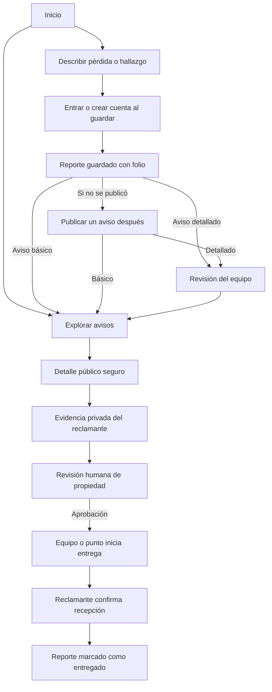

# Interfaz implementada de LocalizaT

**Corte:** 6 de octubre de 2026 (revisión de claridad para la comunidad). **Entorno:** desarrollo local con Django, PostgreSQL, React, TypeScript, Vite y Docker Compose.

## Dirección visual

La interfaz parte de la [identidad v4](GUIA_IDENTIDAD_LocalizaT_v4.md): candado abstracto abierto, verde bosque `#0F4D3A`, ocre `#F4B740` y Manrope. La portada combina tipografía amplia, espacio libre e ilustraciones de objetos sobre un recorrido que vuelve. Las líneas de relieve hacen referencia al territorio de la Sierra de Zongolica, sin sugerir rastreo en tiempo real.

Los assets son SVG originales y variantes del logo existente. Las tarjetas señalan expresamente que su imagen es una ilustración de categoría. El catálogo y los conteos operativos proceden de la API; la interfaz no inventa avisos ni cifras de impacto.

La [exploración azul petróleo y lima](../../frontend/public/exploracion-color.html) compara una paleta distinta manteniendo el símbolo v4. Es una muestra separada; los colores de la aplicación siguen siendo los de la guía v4 hasta elegir la revisión final.

## Pantallas y recorridos

| Ruta | Qué permite |
|---|---|
| `/` | Entender la propuesta, elegir pérdida o hallazgo y ver avisos recientes. |
| `/explorar` | Buscar, filtrar por tipo, categoría, zona y fechas, y cambiar de página. |
| `/avisos/:id` | Consultar el resumen seguro, compartir el enlace y solicitar devolución. Al iniciar sesión se retoma la solicitud. Si el aviso ya no es público, la cuenta puede continuar hacia su reporte o su solicitud existente. |
| `/reportar` | Completar tres pasos sin cuenta; se requiere autenticación al guardar. El aviso básico se publica al momento; texto y zona detallados pasan por revisión. También se puede guardar solo en privado. |
| `/mi-espacio` | Ver mis reportes, solicitudes de devolución y novedades. Cada sección explica qué contiene. |
| `/mis-reportes/:id` | Ver el siguiente paso, la visibilidad del aviso y las coincidencias; abrir un hallazgo conservando el reporte de pérdida que originó la consulta. |
| `/operacion` | Panel del equipo: secciones con conteos que abren en lo pendiente; comparación de la evidencia con la pista secreta y la descripción del hallazgo; registro de entrega y custodia. |

El acceso a operación depende del rol. El equipo dispone de revisión, métricas y traslados; los miembros de puntos activos disponen del inventario y la recepción permitidos. Django vuelve a verificar los permisos en cada solicitud.



## Componentes y movimiento

- **Radix Dialog:** diálogos con gestión de foco, cierre con Escape y asociación de título y descripción.
- **Motion:** revelados de secciones y transiciones suaves; se desactivan o reducen al detectar `prefers-reduced-motion`.
- **Lenis:** desplazamiento suave solo en la portada; no interviene en los formularios ni dentro de diálogos. Se desactiva cuando se solicita reducir movimiento.
- **Lucide React:** iconos consistentes, acompañados de texto o nombres accesibles cuando son botones.
- **React Router:** rutas y navegación; las páginas se cargan por demanda para dividir el JavaScript inicial.
- **Componentes propios:** botones con estado ocupado, tarjetas, etiquetas, formularios, estados vacíos, carga, error con reintento y avisos de resultado.

Referencias visuales: [React Bits Pro](https://pro.reactbits.dev/) y [Lenis](https://lenis.dev/). El diseño y las ilustraciones se construyeron para LocalizaT; no se incorporó código premium de React Bits. Documentación técnica: [Lenis](https://github.com/darkroomengineering/lenis), [Motion y movimiento reducido](https://motion.dev/docs/react-use-reduced-motion), [Radix Dialog](https://www.radix-ui.com/primitives/docs/components/dialog).

## Decisiones de UX

1. Las acciones principales usan lenguaje directo: perder, encontrar, reportar y solicitar devolución. La portada explica el servicio y ofrece buscar antes de reportar. El folio aparece como «número de reporte» en segundo plano.
2. **Cada caso responde «¿Qué sigue?».** `domain.ts` traduce estados a una explicación y una acción principal. Los pasos no marcan como cumplidas ni la publicación opcional ni una entrega pendiente. La visibilidad del aviso se explica aparte; las etiquetas de publicación y entrega tienen dominios distintos.
3. El registro distingue la descripción privada («cómo es», «tu detalle secreto») del aviso público. La opción por defecto publica un aviso básico que Django genera solo con categoría y región. Quien quiera añadir texto o zona puede enviarlos a revisión. El reporte también puede permanecer privado.
4. Una coincidencia es una sugerencia. No autoriza propiedad ni entrega automática; para pérdidas se ofrece «Revisar este hallazgo». Puede consultarse aunque la pérdida esté privada. Una solicitud aprobada mantiene explícito que falta coordinar y confirmar la entrega.
5. Las notificaciones se llaman **Novedades** para no confundirlas con los avisos públicos.
6. **Legibilidad:** una capa final de `styles.css` fija mínimos de 13 px en textos de apoyo, 15 px en etiquetas, 16 px en campos (evita el zoom automático en celulares) y 44 px en zonas táctiles. En móvil, el dibujo del aviso se reduce para que la acción principal quede en la primera pantalla.
7. La evidencia de propiedad solo se presenta al reclamante y al personal autorizado. El catálogo no expone contactos ni descripción privada. El equipo ve, junto a la evidencia, la pista secreta del reporte de pérdida y la descripción de quien encontró el objeto, además de los correos para coordinar la entrega.
8. La confirmación exige que el reclamante marque que ya recibió y revisó el objeto; puede hacerlo desde su caso, sin cambiar de pantalla.
9. El móvil tiene navegación inferior, controles de entrada legibles y diálogos desplazables. El escritorio organiza la revisión en listas y paneles.
10. Se ofrecen mensajes de carga, estado vacío, error y reintento. Las pantallas que dependen de reclamaciones esperan esos datos para no mostrar un estado equivocado.
11. La fuente se sirve localmente. No se solicitan ubicación ni cámara. Las notificaciones del dispositivo se ofrecen voluntariamente en Mi espacio y solo para posibles coincidencias; la bandeja interna funciona sin ese permiso.

## Estructura para aprender

```text
frontend/
  src/
    App.tsx                 Rutas, sesión, navegación, autenticación y contador de novedades
    api.ts                  Tipos y llamadas a Django con cookies y CSRF
    domain.ts               Vocabulario del dominio y «¿Qué sigue?» de cada caso
    context.tsx             Sesión, avisos de resultado y novedades sin leer
    lib.ts                  Fechas y carga asíncrona
    hooks/useAction.ts      Estado ocupado y error de cada envío al servidor
    components/
      ui.tsx                Controles reutilizables, NextStep y StatusPill
      Art.tsx               Ilustraciones SVG originales
      PublishDialog.tsx     Publicar o corregir un aviso
    pages/
      Home.tsx              Portada
      ReportWizard.tsx      Registro en tres pasos con aviso opcional
      explore/              Catálogo, detalle público y solicitud de devolución
      dashboard/            Tus casos, detalle de mi caso, reclamaciones y novedades
      operations/           Panel del equipo: avisos, reclamaciones, coincidencias, custodia
    styles.css              Sistema visual, adaptación al móvil y capa de legibilidad
  public/                   Marca v4, favicon y Manrope con licencia
```

## Comprobación

Se recorrieron en el navegador el registro e inicio de sesión, la creación de un hallazgo, su solicitud y aprobación de publicación, su aparición en el catálogo, la reclamación desde móvil, la revisión del equipo y la confirmación final desde la cuenta reclamante. El caso y las cuentas empleados están identificados como ficticios. No representan una recuperación real ni evidencia de impacto.

Se revisaron la portada y el catálogo a 390 × 844, el uso de los diálogos, el foco inicial de autenticación y la ausencia de desbordamiento horizontal en las vistas observadas. Las capturas están en `output/ui/`. La comprobación visual es una revisión de desarrollo; todavía hace falta observar a personas reales usando el sistema con los dispositivos y la conectividad de la región.

Resultado del cierre: `npm run build` completó la comprobación de TypeScript y la compilación de Vite sin avisos de tamaño; las 10 pruebas de Django pasaron sobre PostgreSQL, incluyendo los permisos de inventario, la recepción por folio y la lectura limitada de entregas. No se observaron errores ni advertencias en la consola del navegador al revisar la portada final. Las tres cuentas ficticias usadas en la prueba se desactivaron y la cuenta operadora quedó sin permisos de equipo. El expediente ficticio se conserva como entregado en el entorno local.

**Revisión del 6 de octubre.** Se recorrió el camino completo a 375 × 812 con cuentas de prueba de cada rol (dos usuarios, operador y miembro de punto, en la base local): registrar un hallazgo con aviso en el mismo paso, ver el aviso como dueño y como visitante, reclamar desde la pérdida, comparar y aprobar como equipo, registrar la entrega y confirmarla desde el caso. Los problemas observados (estados duplicados, coincidencia escondida, error al reclamar dos veces, decisión del equipo sin contexto, textos de 8–11 px) se corrigieron. `npm run build` y las 12 pruebas de Django pasaron. Sigue pendiente observar a personas reales de la Sierra.

**Segunda revisión del 6 de octubre.** Se comprobó a 390 × 844 que una persona sin cuenta puede describir y revisar el objeto, cerrar el diálogo de cuenta conservando el formulario y guardar después de autenticarse. Se guardó un reporte ficticio privado y se revisaron su siguiente paso y su visibilidad. También se comprobó que iniciar sesión desde «Solicitar devolución» abre directamente el formulario y que la URL pública de un reporte privado ofrece continuar al caso propio. La compilación pasó; 9 pruebas de los estados de interfaz y las 12 pruebas de Django pasaron. Las capturas y el [análisis de claridad](MEJORAS_CLARIDAD_LocalizaT.md) documentan este corte. Estas comprobaciones de desarrollo no sustituyen pruebas con habitantes de la Sierra.

```powershell
docker compose up --build -d
docker compose exec -T api python manage.py test accounts reports matching claims custody notifications audit
cd frontend
npm ci
npm test
npm run build
```

## Límites actuales

Las coincidencias del backend todavía son por reglas y palabras. No se muestran porcentajes de certeza de IA. Faltan fotos privadas, recuperación de contraseña y verificación de correo. Web Push para posibles coincidencias ya está implementado, pero falta validar la recepción real en varios dispositivos. Los puntos se configuran en Django Admin y su operación real requiere acuerdos. El entorno Docker actual sirve para desarrollo; las tareas de producción siguen en la especificación técnica general.
