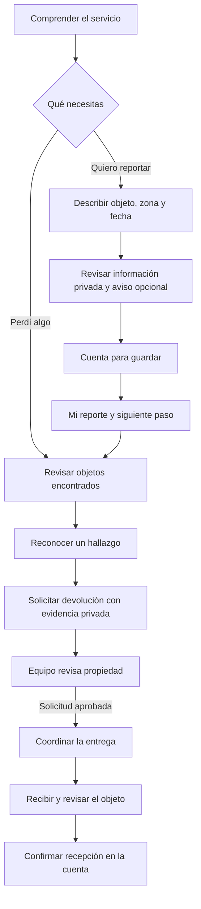

# Claridad del recorrido de LocalizaT

**Fecha:** 6 de octubre de 2026. Revisión del código actual, de su API y del recorrido en navegador. El texto compartido del otro agente se utilizó como contexto; el comportamiento se comprobó en el sistema.

## Lo que ya ayudaba

La división de las pantallas por dominio facilita mantener el código. Los mensajes de siguiente paso, la evidencia reservada al equipo y la mayor legibilidad son una buena base. El problema restante estaba en lo que una persona podía deducir de la pantalla: publicar, encontrar una coincidencia, aprobar una solicitud y recibir un objeto son hechos diferentes.

## Problemas y cambios

| Problema observado | Cambio implementado |
|---|---|
| La portada explicaba la marca con una frase abstracta. | Describe que sirve para reportar y buscar objetos en la Sierra de Zongolica. Ofrece ver hallazgos antes de reportar y una ayuda breve. |
| El acceso a cuenta aparecía antes del formulario. | Permite describir y revisar sin cuenta. Se pide al guardar y el formulario se conserva al cerrar ese diálogo o autenticarse dentro del mismo recorrido. |
| La publicación parecía obligatoria para buscar coincidencias. | Una pérdida privada dirige a buscar o revisar hallazgos. Compartir un aviso se mantiene como opción separada. |
| Los pasos podían marcar avance sin tener esos hechos registrados. | La publicación opcional sale de la secuencia obligatoria. Aprobar una solicitud conserva la recepción como pendiente. Se distingue el estado del caso de la visibilidad del aviso. |
| `pending` podía mostrarse como «Entrega iniciada» al ser una publicación. | Las etiquetas se resuelven por dominio: reporte, publicación, solicitud y entrega. |
| Una solicitud rechazada reciente podía ocultar otra entrega pendiente. | Se priorizan confirmación, entrega pendiente y aprobación antes de solicitudes rechazadas. Las vistas personales filtran por la cuenta reclamante. |
| «Lo que reclamé» no explicaba la relación con «Mis reportes». | Se llama «Solicitudes de devolución» y se explica qué contiene cada sección. Las tres pestañas quedan visibles en móvil. |
| Entrar a la cuenta desde un hallazgo obligaba a comenzar otra vez. | Se conserva la intención y se abre el formulario después de autenticarse. |
| Con varias pérdidas de la misma categoría podía vincularse la equivocada. | La coincidencia conserva el ID de la pérdida de origen. Sin ese origen solo se propone un reporte cuando hay una única opción de esa categoría. |
| Las novedades llevaban a una lista, sin abrir la solicitud correspondiente. | Las solicitudes pueden abrirse por enlace directo. Una novedad relacionada dirige a la solicitud específica. |
| Un enlace público desaparecía al reservar el hallazgo. | La cuenta puede continuar a su solicitud existente aunque el aviso público ya no esté disponible. Los errores de conexión conservan el reintento. |
| «Te avisaremos» podía interpretarse como correo o SMS. | La ayuda y los estados aclaran que las actualizaciones están dentro de la plataforma y que debe volver a consultarlas. |

## Recorrido que se busca explicar

## Comprobaciones

- TypeScript y compilación de Vite: correctos.
- 9 pruebas de interfaz sobre estados y decisiones del recorrido: correctas. Cubren publicación opcional, coincidencias privadas, aprobación sin entrega, rechazo, confirmación, custodia y selección de la solicitud principal.
- 12 pruebas del backend sobre PostgreSQL: correctas.
- Navegador a 390 × 844: reporte sin cuenta, conservación del formulario al cerrar autenticación, creación de cuenta, guardado privado y detalle del caso.
- Navegador: autenticación desde un hallazgo y continuación directa a la solicitud; salida hacia el caso propio desde un enlace público no disponible.
- El reporte creado durante esta revisión está marcado como ficticio y se mantuvo privado. La cuenta de prueba se desactivó al terminar. Los datos del recorrido previo se conservaron.
- Capturas: `output/ui/claridad_2026_10_06/`.

El formulario se conserva en la memoria del recorrido; recargar o abandonar la página puede perder un borrador sin guardar. La IA semántica, el envío externo de novedades y la coordinación estructurada de lugar y hora de recogida siguen pendientes.

## Siguiente validación con personas

Dar a tres o cuatro personas tareas concretas, sin explicar los botones: «perdiste tu mochila», «encontraste un cuaderno», «reconoces tu objeto en un aviso» y «ya te lo entregaron». Observar dónde dudan, qué creen que será público, dónde esperarían la respuesta y si distinguen aprobación de entrega. Registrar los resultados como pruebas de uso, con su número real de participantes; no convertirlos en estadísticas de la región.
