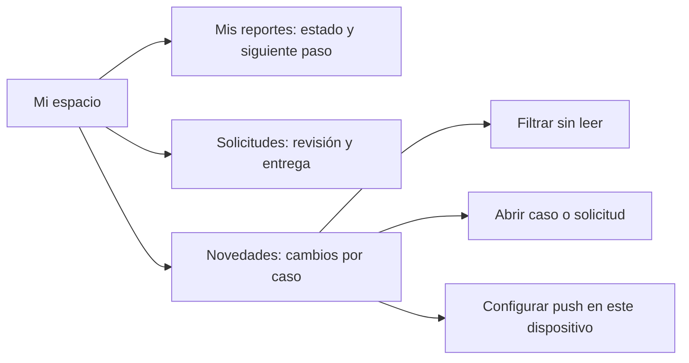

# Revisión UX/UI de «Mi espacio»

**6 de octubre de 2026.** Se conserva la paleta de LocalizaT: verde bosque `#0F4D3A`, ocre `#F4B740`, fondo claro y tipografía Manrope. La portada y el formulario de reporte ya dan una dirección visual propia; esta revisión se concentró en el seguimiento de casos, a partir de la captura de Novedades que mostró el usuario.

## Qué cambió

| Antes | Ahora |
|---|---|
| El encabezado definía las tres pestañas en un párrafo largo. | «Mi espacio» explica su propósito en una frase; cada pestaña lleva un icono, nombre corto y sección propia. |
| Todas las novedades parecían la misma tarjeta. | Cada una muestra su tipo —coincidencia, solicitud, aviso público o entrega—, título, fecha, texto y acción cuando hay un caso enlazado. |
| No había manera rápida de ver qué faltaba leer. | Hay conteo y filtro «Todas / Sin leer». Leer una novedad actualiza la campana. |
| La configuración push ocupaba la parte superior de la lista. | En escritorio es un panel lateral; en móvil, primero se ven las novedades y después la configuración. |
| El primer intento de activar push podía fallar por un service worker aún inactivo. | El registro espera a que el worker esté activo antes de suscribirse y muestra un error comprensible si no se prepara. |

## Reglas de diseño que se mantienen

1. El estado visible debe expresar hechos registrados: una posible coincidencia no significa propiedad verificada ni devolución confirmada.
2. La acción importante acompaña al mensaje correspondiente. «Marcar como leída» tiene menor peso visual que «Ver mi caso» o «Ver mi solicitud».
3. La configuración de avisos push es voluntaria y se refiere solo a posibles coincidencias; la bandeja interna conserva todas las novedades.
4. En móvil, el contenido de seguimiento aparece antes de ajustes. Los tres accesos del espacio permanecen visibles y utilizables.
5. El verde guía acciones y estados; el ocre se reserva para una señal de atención. La diferencia entre leído y no leído no depende solo del color: también cambia el borde y queda el filtro.

## Validación de este corte

Se revisó la portada y el formulario como contexto, y «Mi espacio → Novedades» en escritorio y en 390 × 844 con una cuenta local de prueba y cuatro novedades sintéticas. El conjunto de prueba permite comprobar jerarquía y tamaños; no representa actividad real de usuarios. La compilación de TypeScript/Vite y las pruebas existentes del frontend pasaron. La activación push real debe repetirse en Chrome con permiso de notificaciones; la corrección del estado del service worker se basa en la [documentación de MDN](https://developer.mozilla.org/en-US/docs/Web/API/ServiceWorkerContainer/ready).

## Siguiente prueba con personas

Pedir a tres personas que entren sin orientación y respondan: «¿Dónde verías lo que perdiste?», «¿Qué significa posible coincidencia?», «¿Qué harías antes de confirmar la recepción?» y «¿Cómo activarías o desactivarías los avisos?». Registrar dudas y tiempo de cada tarea con sus bases reales; luego ajustar palabras y jerarquía según lo observado.
